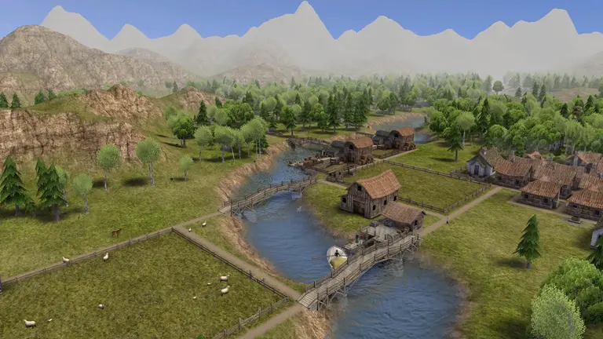

<p align="center">
  
</p>

<p align="center">
  <strong>Play <em>Banished</em> on Windows, macOS and Linux, or in a web browser.</strong><br>
  A new game engine, written in Rust. It uses the game files from your own copy of Banished.
</p>

<p align="center">
  <a href="#licence"></a>
  
  
</p>

<p align="center">
  <a href="https://tanepiper.github.io/unbanished/"><strong>Website</strong></a> ·
  <a href="https://tanepiper.github.io/unbanished/play"><strong>Play in your browser</strong></a> ·
  <a href="docs/USER-GUIDE.md">Setup guide</a> ·
  <a href="#get-started">Get started</a> ·
  <a href="#controls">Controls</a> ·
  <a href="#faq">FAQ</a> ·
  <a href="docs/PROCESS.md">How it was made</a> ·
  <a href="AGENTS.md">Contributing</a>
</p>

<p align="center">
  
</p>

## What is Un-Banished?

[Banished](https://www.shiningrocksoftware.com/) is a city-building game by Shining Rock
Software. In the game, a group of exiled travellers build a new town in a hard land. The game
runs only on Windows. Its last version is 1.0.7.

**Un-Banished is a new engine for this game.** All of its code is new. It contains no code, art,
sound or text from the original game. It reads the data files from your copy of Banished, and it
rebuilds the game's rules, menus, graphics and sound around them.

The goal is to match the original exactly. The same seed gives the same map. The citizens, the
timings and the save files are the same.

- 🖥️ **Desktop:** Windows, macOS (Apple Silicon and Intel) and Linux.
- 🌐 **Browser:** through WebAssembly. The page reads your game files on your computer. It does not upload them.
- 💾 **Saves:** saves from the original game load without changes. Un-Banished uses the same save format and the same save folder.
- 🧩 **Mods:** mods made with the BanishedKit (`.pkm` files) work through the Mods menu, as in the original.
- 🔎 **Mod sites:** the Mods menu browses, searches and installs mods from [Nexus Mods](https://www.nexusmods.com/games/banished/mods) and, on the desktop, [banishedinfo.com](https://banishedinfo.com/mods/browse). A [mod manager](docs/USER-GUIDE.md#the-mod-manager) keeps mod lists and starts the game. *Not in the original.*
- 👥 **Multiplayer:** several players can play one town together, on the desktop and in the browser, through a small relay server. *Not in the original.* See [Multiplayer](docs/USER-GUIDE.md#multiplayer).
- 📱 **Install the browser version as an app**, and choose its resolution and frame rate for slow computers, tablets and phones.
- 🎓 **Tutorials, scenarios and achievements** work as in the original.

> [!IMPORTANT]
> **You need your own copy of Banished**, from [Steam](https://store.steampowered.com/app/242920/Banished/)
> or GOG. Un-Banished contains no game content and cannot run without your copy.

## Screenshots

<table>
  <tr>
    <td></td>
    <td></td>
  </tr>
  <tr>
    <td align="center">The main menu</td>
    <td align="center">The first minute of a new town</td>
  </tr>
  <tr>
    <td colspan="2"></td>
  </tr>
  <tr>
    <td colspan="2" align="center">A town loaded from a save</td>
  </tr>
</table>

<sub>All screenshots show Un-Banished running with a player's own copy of the game. The art in
the screenshots belongs to Shining Rock Software.</sub>

Short videos of the game in motion are on the [Playing the game](docs/guide/PLAYING.md) page:
citizens at work close up, a trader's boat on the river, the seasons and an animation.
Un-Banished recorded them itself, without a window.

[](docs/guide/PLAYING.md)

## Status

**Beta.** The whole game runs. You can start a new game or load a save. Your town and its
citizens live through the seasons, and every building and tool works. Trade, disasters, the
event log, options, mods, tutorials and achievements also work. Map generation and most game
rules are checked against the original, value by value. Un-Banished also adds things the original
does not have: mod sites in the Mods menu, a mod manager, and multiplayer.

Some problems remain. They are listed in the
[issues](https://github.com/tanepiper/unbanished/issues). [docs/DEVIATIONS.md](docs/DEVIATIONS.md)
lists the known differences from the original. [docs/PARITY-AUDIT.md](docs/PARITY-AUDIT.md) shows
what has been checked.

If something works differently from the original game, please
[report it](https://github.com/tanepiper/unbanished/issues/new/choose). These reports are the most
useful help you can give.

## Get started

From version 0.5.0, each [release](https://github.com/tanepiper/unbanished/releases) has a
ready-made download for Windows, macOS (Apple silicon and Intel) and Linux: unpack the zip and
run `unbanished`. You can also build Un-Banished yourself. It takes three steps and about five
minutes. The **[setup guide](docs/USER-GUIDE.md)** explains every step for Windows, macOS and
Linux.

```bash
# 1. Download the code
git clone https://github.com/tanepiper/unbanished.git
cd unbanished

# 2. Build it (this needs Rust: https://rustup.rs)
cargo build -p unbanished-app --release

# 3. Start it, and give it your game's WinData folder
target/release/unbanished "/path/to/Banished/WinData"
```

On Windows, step 3 is `target\release\unbanished.exe "C:\Program Files (x86)\Steam\steamapps\common\Banished\WinData"`.

You can also copy the built `unbanished` file (`unbanished.exe` on Windows) into your Banished
folder, next to `WinData`, and start it there. It then works like the original program and uses
the same save folder.

**To play in a browser**, you do not need to build anything. Open the
[Play page on the website](https://tanepiper.github.io/unbanished/play) and select your four game
files.

## Controls

The default controls are the same as in the original game. You can change them in
**Options → Input**.

| Action | Keys / mouse |
|---|---|
| Move the camera | **W A S D**, or move the pointer to the edge of the screen |
| Rotate | **Q** / **E**, or hold the **middle mouse button** and move the mouse |
| Zoom | **Mouse wheel**, or **Insert** / **Delete** |
| Tilt | **Page Up** / **Page Down** |
| Select, place, confirm | **Left click** |
| Cancel a drag, or put the tool away | **Right click** or **Esc** |
| Pause / resume | **Space** |
| Toolbar buttons | **F1 – F9** |
| Tools in an open toolbar menu | **1 – 0** |
| Camera presets | **Z X C V B** |
| Screenshot (without / with the interface) | **Print Screen** / **Scroll Lock** |

## FAQ

**Is this a crack or a pirated copy?** No. Un-Banished contains no game code, art, sound or text,
and it cannot run without your own copy of the game. It is an independent, non-commercial
project.

**How was it made without the source code?** Ghidra turned the game's machine code into
readable pseudocode. An AI agent read the pseudocode and wrote down what each part does. It also
ran the original functions in an emulator to get exact numbers. Then it wrote new Rust code from
these notes and tested the new code against the original. No original code is copied into this
repository. [How Un-Banished was made](docs/PROCESS.md) explains each step.

**Can I use my existing saves?** Yes, on the desktop. Un-Banished uses the same save folder as the
original (`Documents/Banished/Save`), so your towns appear in the Load dialog. The browser
version keeps its own saves inside the browser.

**Do mods work?** Yes, mods made with the BanishedKit (`.pkm` files). On the desktop, put them in
the `WinData` folder. In the browser, select them or drag them onto the page. Then turn them on
in the Mods menu. The Mods menu can also find and install mods from Nexus Mods and (on the
desktop) banishedinfo.com: see [Mods](docs/USER-GUIDE.md#mods).

**Can I play with friends?** Yes, with Multiplayer on the main menu. Every player needs their own
copy of Banished and the same version of Un-Banished. One player hosts a room on a relay and the
others join with its code. See [Multiplayer](docs/USER-GUIDE.md#multiplayer).

**Which browsers work?** We test in recent versions of Chrome and in Firefox Nightly (160), with
both WebGPU and WebGL 2. Edge uses the same browser engine as Chrome, so it should work the same
way.
Un-Banished uses WebGPU when the browser supports it, and WebGL 2 when it does not. Other modern
browsers can also work.

**Does it run on a Steam Deck, a Raspberry Pi, or another device?** It should run on any device
with a graphics card that supports Vulkan, Metal, DirectX 12 or OpenGL ES 3. Please tell us the
result.

## For developers

The project is a Rust workspace:

| Path | What it contains |
|---|---|
| [`apps/game`](apps/game/README.md) | The game (binary `unbanished`), for desktop and browser |
| [`apps/viewer`](apps/viewer/README.md) | A browser for the game's models, textures, sounds and dialogs |
| [`apps/cli`](apps/cli/README.md) | Command-line helpers (for example, audio export) |
| [`apps/modmanager`](apps/modmanager/README.md) | The mod manager (binary `unbanished-mods`) |
| [`apps/server`](apps/server/README.md) | The multiplayer server (binary `unbanished-server`), which the desktop game can also run itself |
| [`crates/core`](crates/core/README.md) | Exact maths, the game's random numbers, noise and game time |
| [`crates/terrain`](crates/terrain/README.md), [`crates/path`](crates/path/README.md) | Map generation and path finding, checked against the original |
| [`crates/game`](crates/game/README.md) | The game rules, checked against the original |
| `crates/sim` | The running town with no drawing, sound or interface: the core the game and the server run |
| `crates/session` | When players' commands are carried out (single player, lockstep), recordings, and the server's own copy of a game |
| [`crates/formats`](crates/formats/README.md) | Readers for the game's `.pkg`, `.crs`, mesh, texture, sound and save formats |
| [`crates/ui`](crates/ui/README.md), [`crates/gfx`](crates/gfx/README.md), [`crates/audio`](crates/audio/README.md), [`crates/wma`](crates/wma/README.md) | Interface, rendering, audio, and the WMA decoder |
| [`crates/mods`](crates/mods/README.md), [`crates/nexus`](crates/nexus/README.md), [`crates/banishedinfo`](crates/banishedinfo/README.md) | The mod list shared by the game and the mod manager; optional Nexus Mods and banishedinfo.com support (not part of the original game) |
| [`crates/net`](crates/net/README.md) | Multiplayer networking: the protocol, the rooms' rules and a WebSocket connection (not part of the original game) |
| `docs/` | Everything we learned about how the original works, [how Un-Banished is built](docs/ARCHITECTURE.md), and the [developer documentation](docs/develop/README.md) |
| `tools/` | Data extraction, emulator checks, analysis scripts, screenshots and videos |

```bash
tools/extract-assets.sh              # copy your game data into game-data/ (git ignores it)
tools/test/run.py                    # the quick tests; tests that need game data are skipped without it
cargo run -p unbanished-viewer --release
```

Read **[AGENTS.md](AGENTS.md)** before you contribute, by hand or with an AI agent. It contains
the project rules, the checks to run before each commit, and a map of the code.
The [developer documentation](docs/develop/README.md) explains how to build, test and port, and
[the topics](docs/topics/README.md) explain how the parts of the game work.
[docs/FINDINGS.md](docs/FINDINGS.md) is the first of the research notes.
[docs/PROCESS.md](docs/PROCESS.md) explains the method. Issues and pull requests use the
templates in [.github/](.github/).

## Licence

Un-Banished's source code is licensed under either of

- the [Apache License, Version 2.0](LICENSE-APACHE), or
- the [MIT licence](LICENSE-MIT)

at your option.

Unless you explicitly state otherwise, any contribution you intentionally submit for inclusion in
the work, as defined in the Apache-2.0 licence, is dual-licensed as above, without any additional
terms or conditions.

The licence covers only the code and documents in this repository. It does not cover Banished or
its data. You must supply those yourself.

The lettering in the Un-Banished logo uses the EB Garamond typeface, which is licensed under the
SIL Open Font License 1.1.

## Legal

Banished is © Shining Rock Software, LLC. Un-Banished is **not affiliated with or endorsed by
Shining Rock Software**. We use the name "Banished" only to say which game this engine plays.
The screenshots above show the original game's art. Un-Banished drew them from a player's own
copy of the game.

This repository contains no game files, no extracted assets and no decompiled code.
Contributions must not add any.
