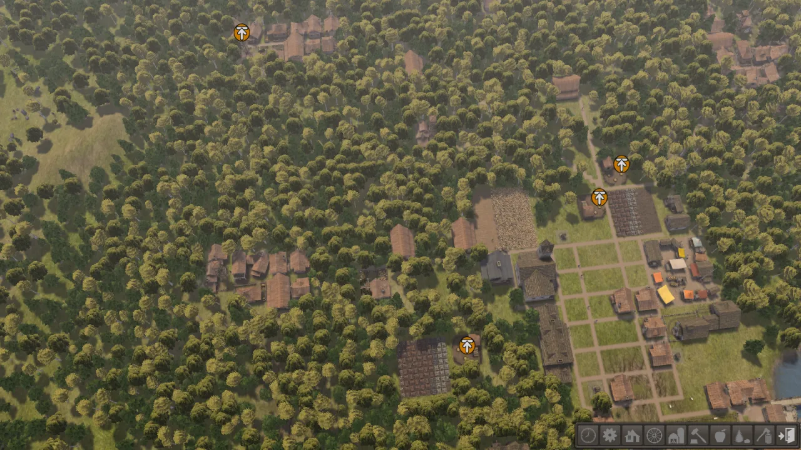

<p align="center">
  
</p>

<p align="center">
  <strong>Play <em>Banished</em> natively on Windows, macOS and Linux, or right in your browser.</strong><br>
  A new engine, written from scratch in Rust, that runs the game data you already own.
</p>

<p align="center">
  <a href="#licence"></a>
  
  
</p>

<p align="center">
  <a href="docs/USER-GUIDE.md"><strong>Setup guide</strong></a> ·
  <a href="#get-started">Get started</a> ·
  <a href="#controls">Controls</a> ·
  <a href="#faq">FAQ</a> ·
  <a href="AGENTS.md">Contributing</a> ·
  <a href="docs/FINDINGS.md">Research notes</a>
</p>

<p align="center">
  
</p>

## What is Un-Banished?

[Banished](https://www.shiningrocksoftware.com/) is a city-building game by Shining Rock Software
about a group of exiled travellers who start a new life in an unforgiving land. It was released
for Windows only, and its last version is 1.0.7.

**Un-Banished is a reimplementation of the game's engine.** Every line of it is new code. It
contains none of the original's code, art, sound or text. Instead, it reads the data files from
your own copy of Banished and recreates the rules, menus, graphics and sound around them. The
target is a **1:1 match**: the same maps from the same seed, the same citizens, the same timings
and the same save files.

- 🖥️ **Native** on Windows, macOS (Apple Silicon and Intel) and Linux.
- 🌐 **In the browser** through WebAssembly. Your game files are read inside the page and never uploaded.
- 💾 **Your existing saves** load as they are: it uses the original's save format and folder.
- 🧩 **Mods** made with the BanishedKit (`.pkm`) work through the Mods menu, as in the original.
- 🎓 **Tutorials, scenarios and achievements**, as in the original.

> [!IMPORTANT]
> **You need your own copy of Banished** from [Steam](https://store.steampowered.com/app/242920/Banished/)
> or GOG. Un-Banished ships no game content and does nothing without it.

## Screenshots

<table>
  <tr>
    <td></td>
    <td></td>
  </tr>
  <tr>
    <td align="center">The main menu</td>
    <td align="center">A new town's first minute</td>
  </tr>
  <tr>
    <td colspan="2"></td>
  </tr>
  <tr>
    <td colspan="2" align="center">A town loaded from a save</td>
  </tr>
</table>

<sub>All screenshots are from Un-Banished running on a player's own copy of the game. The art in them
belongs to Shining Rock Software.</sub>

## Status

**Beta.** The whole game runs. You can start new games and load saves, and play your town and its
citizens through the seasons with every building and tool. Trade, disasters, the event log,
options, mods, tutorials and achievements all work. Map generation and most game rules are checked
number for number against the original.

There are still some rough edges, tracked in the
[issues](https://github.com/tanepiper/unbanished/issues). [docs/DEVIATIONS.md](docs/DEVIATIONS.md)
lists the known differences, and [docs/PARITY-AUDIT.md](docs/PARITY-AUDIT.md) shows what has been
checked. If something plays differently from the original, please
[report it](https://github.com/tanepiper/unbanished/issues/new/choose). Those reports help the
most.

## Get started

There are no ready-made downloads yet, so you build it yourself. It's four commands and about
five minutes. The **[setup guide](docs/USER-GUIDE.md)** walks through every step for Windows,
macOS and Linux.

```bash
# 1. Get the code
git clone https://github.com/tanepiper/unbanished.git
cd unbanished

# 2. Build it (needs Rust: https://rustup.rs)
cargo build -p banished-app --release

# 3. Play, pointing it at your game's WinData folder
target/release/banished "/path/to/Banished/WinData"
```

On Windows, step 3 is `target\release\banished.exe "C:\Program Files (x86)\Steam\steamapps\common\Banished\WinData"`.

You can also copy the built `banished` (or `banished.exe`) into your Banished folder, next to
`WinData`, and run it from there. It then works like the original program, saves included.

**To play in the browser**, see [Play in the browser](docs/USER-GUIDE.md#play-in-the-browser).

## Controls

The defaults match the original game, and you can change them under **Options → Input**.

| Action | Keys / mouse |
|---|---|
| Move the camera | **W A S D**, or push the pointer to the screen edge |
| Rotate | **Q** / **E**, or hold the **middle mouse button** and drag |
| Zoom | **Mouse wheel**, or **Insert** / **Delete** |
| Tilt | **Page Up** / **Page Down** |
| Select, place, confirm | **Left click** |
| Cancel a drag or put the tool away | **Right click** or **Esc** |
| Pause / resume | **Space** |
| Toolbar buttons | **F1 – F9** |
| Tools in an open toolbar menu | **1 – 0** |
| Camera presets | **Z X C V B** |
| Screenshot (without / with the interface) | **Print Screen** / **Scroll Lock** |

## FAQ

**Is this a crack or a pirated copy?** No. Un-Banished contains no game code, art, sound or text,
and it can't run without your own copy of the game. It is an independent, non-commercial
project.

**How was it made without the source code?** By studying how the original program behaves:
tracing what each function does, then running parts of it in an emulator to check exact numbers.
The findings are written up in plain language in [docs/](docs/FINDINGS.md), and the Rust code is
written fresh from those notes. No original code is copied into this repository.

**Can I use my existing saves?** Yes, on the desktop. Un-Banished uses the original's save
folder (`Documents/Banished/Save`), so your towns show up in the Load dialog. The browser version
keeps its own saves inside the browser.

**Do mods work?** Yes, BanishedKit mods (`.pkm`). On the desktop, put them in `WinData`. In the
browser, select them or drop them onto the page. Then turn them on in the Mods menu.

**Which browsers work?** It is tested in recent Chrome, and Edge should behave the same. It uses
WebGPU where the browser has it, and WebGL 2 otherwise, so other modern browsers may work too.

**Will it run on a Steam Deck, a Raspberry Pi, …?** Anything with a GPU that supports Vulkan,
Metal, DirectX 12 or OpenGL ES 3 should work. Please report how it goes.

## For developers

The project is a Rust workspace:

| Path | What it is |
|---|---|
| `apps/game` | The game itself (binary `banished`), native and web |
| `apps/viewer` | An asset browser for models, textures, audio and dialogs |
| `apps/cli` | Command-line helpers (e.g. audio export) |
| `crates/game` | Game rules, checked against the original |
| `crates/formats` | Readers for the game's `.pkg`, `.crs`, mesh, texture, sound and save formats |
| `crates/ui`, `crates/gfx`, `crates/audio`, `crates/wma` | Interface, rendering, audio and the WMA decoder |
| `docs/` | Everything learned about how the original works |
| `tools/` | Data extraction, emulator checks, analysis scripts |

```bash
tools/extract-assets.sh              # copy your game data into game-data/ (git-ignored)
cargo test --release                 # tests that need game data skip when game-data/ is missing
cargo run -p banished-viewer --release
```

Read **[AGENTS.md](AGENTS.md)** before contributing, whether by hand or with an AI agent. It has the
project rules, the checks to run before a commit, and where to find things. Issues and pull
requests use the templates in [.github/](.github/).

## Licence

Un-Banished's source code is licensed under either of

- the [Apache License, Version 2.0](LICENSE-APACHE), or
- the [MIT licence](LICENSE-MIT)

at your option.

Unless you explicitly state otherwise, any contribution you intentionally submit for inclusion in
the work, as defined in the Apache-2.0 licence, is dual-licensed as above, without any additional
terms or conditions.

The licence covers this repository's own code and documentation only. It does not cover Banished
or its data, which you need to supply yourself.

## Legal

Banished is © Shining Rock Software, LLC. Un-Banished is **not affiliated with or endorsed by
Shining Rock Software**. The name "Banished" is used only to say which game this engine plays.
The screenshots above show the original game's art, rendered by Un-Banished from a player's own
copy.

This repository contains no game files, extracted assets or decompiled code, and contributions
must not add any.
