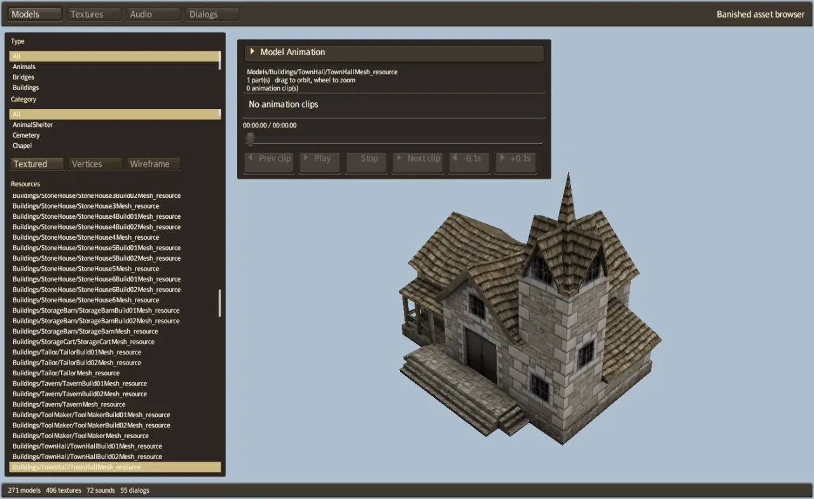
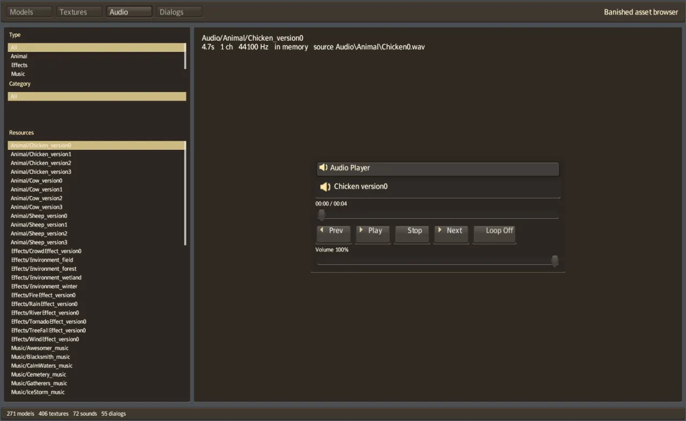

# banished-viewer

An asset browser for the game data of Banished. It shows the game's models (with their
animations), textures, sounds and dialogs. It is drawn with the game's own interface system
(`banished-ui`), so it also tests that system. It runs on the desktop and in the browser.

<p align="center">
  
</p>

## Build and run

```bash
cargo run -p banished-viewer --release                       # reads game-data/original/WinData
cargo run -p banished-viewer --release -- /path/to/WinData   # or another WinData folder
```

In the browser:

```bash
tools/dev-web.sh --release      # http://127.0.0.1:8731/?data=/game-data/
```

Without `?data=`, the page asks you to choose the four `.pkg` files.

## The four modes

The buttons at the top choose the mode. In each mode, the lists on the left filter the resources
by type and category, and the **Resources** list shows the matching entries. The bar at the
bottom shows how many of each kind the game data holds (for Banished 1.0.7: 271 models, 406
textures, 72 sounds and 55 dialogs).

| Mode | What it shows |
|---|---|
| **Models** | A mesh with its materials. Choose **Textured**, **Vertices** or **Wireframe**. If the mesh has animations, the **Model Animation** panel plays its clips: previous and next clip, play, stop, and steps of 0.1 seconds. |
| **Textures** | A texture, with its size, format, mip levels and source file name |
| **Audio** | A sound, with its length, channels, sample rate and source file name. The **Audio Player** panel plays it, with a position bar, loop and volume. |
| **Dialogs** | A dialog of the game, drawn as the game draws it. Animated dialogs (such as the loading screen) can be played frame by frame. |

<p align="center">
  
  
</p>

## Controls

| Action | Control |
|---|---|
| Choose a mode, a filter or a resource | Click it |
| Next or previous resource | **Down** / **Up** |
| 20 resources forward or back | **Page Down** / **Page Up** |
| Step an animation by 0.1 seconds (Models) | **Right** / **Left** |
| Turn the model | Drag with the left mouse button |
| Zoom | Mouse wheel |

## Headless commands

Two commands draw without a window and stop. They read `game-data/original/WinData`.

| Command | What it does |
|---|---|
| `banished-viewer --screenshot FILE.png [MODE] [FILTER]` | Draw the whole viewer at 1400 × 860. `MODE` is `models`, `textures`, `audio` or `dialogs`. `FILTER` selects the first resource whose name contains it. |
| `banished-viewer --capture OUT_DIR [FILTER …]` | Draw every mesh whose name contains one of the filters, alone, as a 512 × 512 PNG in `OUT_DIR` |

For `--capture`, two environment variables pose animated meshes:

| Variable | Effect |
|---|---|
| `VIEWER_POSE=CLIP@SECONDS` | Pose each mesh with the clip `CLIP` at `SECONDS` |
| `VIEWER_ANIMS=TEXT` | Look for the clip only in animation groups whose name contains `TEXT` |

```bash
# The screenshots on this page
banished-viewer --screenshot models.png models TownHallMesh
banished-viewer --screenshot dialogs.png dialogs MainMenu_resource

# Every chicken mesh, in the Walk clip at 0.5 seconds
VIEWER_POSE=Walk@0.5 VIEWER_ANIMS=Chicken banished-viewer --capture chickens/ ChickenMesh
```

A sequence of `--capture` runs at increasing times gives the frames of an animation. The
chicken video on the [Playing](../../docs/guide/PLAYING.md) page was made this way.

## Source files

| File | What it contains |
|---|---|
| `src/main.rs` | The window, the event loop, the headless commands, the browser's file chooser |
| `src/tool.rs` | The browser's interface: modes, lists, filters, the camera |
| `src/assets.rs` | Reading the packages and listing the resources by kind |
| `src/render.rs`, `src/mesh.wgsl` | Drawing meshes (with skinning) and the interface |
| `src/model_player.rs`, `src/dialog_player.rs`, `src/audio_player.rs`, `src/player.rs` | The animation, dialog and audio panels |
