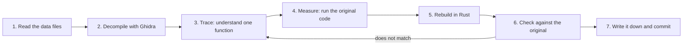

# How Un-Banished was made

This page explains, in plain language, how Un-Banished was built. We did not have the source code
of Banished. We had only the finished game: the program files and the data files. From these we
worked out how the game behaves, and then we wrote a new engine that behaves the same way.

The work used three tools and one person:

- **Ghidra**, a free program that turns machine code back into readable code.
- **REA** (Reverse Engineer Anything), a toolkit and method for studying finished programs.
- **An AI coding agent** (Claude Code), which did most of the reading, testing and writing.
- **A human**, who chose the goals, played the game, found problems and made the decisions.

The sections below explain each part and how they worked together.

- [What we started with](#what-we-started-with)
- [The tools and who did what](#the-tools-and-who-did-what)
- [The process, step by step](#the-process-step-by-step)
- [An example: the name generator](#an-example-the-name-generator)
- [What "from scratch" means here](#what-from-scratch-means-here)
- [How the agent was guided](#how-the-agent-was-guided)
- [In numbers](#in-numbers)
- [Limits](#limits)

## What we started with

A copy of Banished 1.0.7 (Steam build 170910) contains two kinds of files.

**Program files.** These are the parts that run:

| File | What it does |
|---|---|
| `Application-steam-x64.exe` | The game itself: the rules, the citizens, the menus |
| `Runtime-steam-x64.dll` | The engine: files, memory, maths, sound, the interface system |
| `VideoDX9` / `VideoDX11` | Drawing on screen with Direct3D |

These files contain machine code. Machine code is a long list of numbers that the processor
runs. People cannot read it directly.

**Data files.** These are four `.pkg` packages in the `WinData` folder. They hold the art, the
sound, the text, the menus, and many numbers for the game rules (for example, how long a tree
takes to grow).

We did not have the source code. Source code is the readable text that the original developer
wrote and then turned into machine code. So the first problem was to understand the program
without it.

## The tools and who did what

### Ghidra: from machine code to readable code

[Ghidra](https://ghidra-sre.org/) is a free tool for studying programs. It reads machine code and
produces *pseudocode*: an approximate version of the code in a C-like language. Pseudocode has
no real names. A function is called `FUN_1400aa000`, which means "the function at address
`0x1400aa000`". A value is called `+0x44`, which means "the value 0x44 bytes into this object".

We ran Ghidra without its window, from a script (`tools/ghidra/export.sh`). The script analyses
both program files and writes every function's pseudocode into one large text file. This takes
about 20 minutes. The agent can then search that file like any other text.

The pseudocode stays on the local computer. It is in the `analysis/` folder, which git ignores,
so it is never published.

### REA: a method for studying finished programs

REA (Reverse Engineer Anything) is a toolkit that lets an AI agent inspect a finished program:
its files, its functions, its strings, and its behaviour while it runs. It also gives a strict
way of working:

- Study the program that was actually shipped, not a guess about it.
- Connect every claim to evidence: an address, a value, or an observation.
- Keep a list of open questions instead of filling gaps with guesses.

This method shaped the whole project. Every finding in `docs/` says what kind of evidence it
rests on, and marks guesses as *inferred*.

REA can connect to Ghidra itself. In this project that connection was usually not set up, so the
agent read the separate Ghidra export described above. The documents say this openly. For
example, some of them note that a finding comes from the existing export and not from a new REA
session.

### The AI agent: reading, measuring, writing

The agent did most of the detailed work. For each part of the game it:

1. searched the pseudocode for the right function;
2. read it and explained it in plain words;
3. ran the original function to get exact results (see [Measure](#4-measure-run-the-original-code));
4. wrote new Rust code that does the same thing;
5. wrote a test that compares the new code with the original;
6. wrote down what it learned in `docs/`.

The agent worked inside rules written for it (see
[How the agent was guided](#how-the-agent-was-guided)). Several agent sessions often worked on
different parts of the game at the same time.

### The human: direction and judgement

The human did the things an agent cannot do alone:

- chose what to work on next, and in which order;
- played both games and reported differences (the [issues](https://github.com/tanepiper/unbanished/issues));
- ran the original game on a Windows PC and streamed it to a Mac, so the agent could see the real
  game and compare screenshots;
- decided what to do when the evidence was unclear, and what to publish.

### Summary

| Who or what | Main job | Output |
|---|---|---|
| Ghidra | Turn machine code into pseudocode | A local text file of all functions |
| REA | Give the method and the inspection tools | Evidence-first findings |
| AI agent | Read, measure, write code and tests | Rust code, tests, documents |
| Human | Choose goals, play, judge, decide | Priorities, bug reports, decisions |

## The process, step by step

Every part of the game went through the same loop. The diagram shows it; the text below explains
each step.

### 1. Read the data files

Before the game can run, it must read its packages. Each `.pkg` file contains hundreds of
resources: textures, models, sounds, menus, and rule tables. Each resource has a type, written
as a number.

The agent found the code in the program that registers each type. That code links each number to
a name, such as a texture or a dialog. With these names, the agent identified all 170 resource
types. Then it wrote readers for the formats the game uses, in `crates/formats`. A reader's test
reads every resource of its type in the real packages and checks that nothing is left over.

### 2. Decompile with Ghidra

Ghidra turned both program files into pseudocode, as described above. Each new agent session
starts from this export, so it does not need to run Ghidra again.

### 3. Trace: understand one function

Tracing means following the program from a known point to the part you need. For example, to
learn how a tree grows, start from the main game loop, find the call that updates trees, and read
that function.

The agent used several kinds of clues:

- **Strings.** Text such as `"Template/Citizen.rsc"` shows where the program uses a resource.
- **Exported names.** The engine file exports many functions with their real C++ names. These
  names show what many engine functions do.
- **Tables of functions.** C++ objects keep their functions in a table. Reading one table
  (`tools/ghidra/vtable.py`) shows all the actions an object type supports.
- **Constants.** Numbers stored in the program, such as a growth time, are read directly from
  the file (`tools/ghidra/readdata.py`).

The result of a trace is a short document in `docs/` (start at [FINDINGS.md](FINDINGS.md)),
written in prose and tables. It names the
functions by address, describes what they do, and lists the open questions. It never copies the
pseudocode.

### 4. Measure: run the original code

Reading code can be wrong. Small details matter: the order of a calculation changes the last digit
of a decimal number, and in a simulation small errors grow over time. So for any function with
numbers in it, the agent measured the original directly.

For this the project has its own emulator, `tools/emu/pe_emu.py`, built on the
[Unicorn](https://www.unicorn-engine.org/) library. An emulator is a program that pretends to be a
processor. The harness:

1. loads the original game and engine files into memory, at the addresses they expect;
2. connects the game to the engine, as Windows would;
3. replaces the operating-system parts with small stand-ins;
4. calls one original function with chosen inputs, and records what it returns.

The game itself never starts. Only the one function runs, thousands of times, with different
inputs. The results are saved in the local `game-data/derived/emu/` folder. There are emulator
scripts for random numbers, terrain, path finding, tree growth, names, storage, picking, animation
and more.

### 5. Rebuild in Rust

Now the agent writes new code in [Rust](https://www.rust-lang.org/). The new code follows the
notes from step 3, not the pseudocode line by line. It uses clear names, Rust types, and the
project's own structure.

Each ported function says where its behaviour comes from, in a comment such as
`/// Port of FUN_1400be680: …`. If something is a guess, the comment says *inferred*. If the new
code behaves differently on purpose, the comment says `Deviation:`, and a script collects all
deviations into [DEVIATIONS.md](DEVIATIONS.md).

Rendering is rebuilt in the same way. The original draws with Direct3D shaders. The agent read
those shaders and wrote new versions in WGSL for [wgpu](https://wgpu.rs/), which runs on Vulkan,
Metal, DirectX 12 and in the browser.

### 6. Check against the original

The project checks the new code in four ways:

- **Tests against the emulator.** A Rust test reads the saved results from step 4 and checks that
  the new code gives exactly the same answers. Exactly means bit for bit, including decimal
  numbers. These tests skip when the game data is missing, so they never need game files in the
  repository.
- **Determinism.** `tools/triage/determinism.sh` runs the same new game twice with the same seed
  and checks that the two pictures are identical. This catches hidden randomness.
- **Save files.** Saves from the original game must load, and their contents must read back
  correctly.
- **Pictures of the real game.** The original runs on a Windows PC and streams to a Mac with Steam
  Remote Play. The agent takes screenshots of both games in the same situation and compares them
  with an image-difference tool.

When a check fails, the work goes back to step 3.

### 7. Write it down and commit

The agent updates the documents, ticks the item in
[GAME-LOOP-CHECKLIST.md](GAME-LOOP-CHECKLIST.md), and commits only its own files. The commit
message says what was traced and how it was checked.

## An example: the name generator

Every citizen in Banished has a name, and each new town gets a name too. The names look real but
are invented. The game builds each name one letter at a time. A database lists, for every group of
four letters, which letters may come next. The game picks one of them at random, moves on by one
letter, and repeats. Here is how that part was rebuilt.

1. **Read.** The packages contain three name databases: male names, female names and town names.
   The agent wrote a reader for their format.
2. **Trace.** The agent found two functions. `FUN_1400a9d50` builds one name. `FUN_1400aa000`
   calls it up to 50 times and keeps the first name that is long enough and is not a real name
   from the database. The agent worked out how each letter is chosen with the game's random
   number generator, and how the generator decides where a name ends.
3. **Measure.** The script `tools/emu/names.py` runs the original generator in the emulator. For
   each database and for random seeds 1 to 40, it makes 25 names in a row. That is 3,000 names
   from the original code.
4. **Rebuild.** The agent wrote the generator again in Rust, in `crates/game`.
5. **Check.** The test `crates/game/tests/names_emu.rs` makes the same 3,000 names with the new
   code and compares them with the original. All of them match. Because the names come one after
   another from one random sequence, this also proves that the new code uses random numbers in
   exactly the same order as the original.
6. **Record.** The findings are in [TOWN-NAME-DATABASE.md](TOWN-NAME-DATABASE.md).

The same pattern was used for terrain generation, path finding, tree growth, storage, animation
and many other systems.

## What "from scratch" means here

"From scratch" means:

- **All code in this repository is new.** It was written for Un-Banished, in Rust.
- **No original code is copied.** We read the pseudocode to understand the game. We did not
  translate it line by line, and we never put it in the repository.
- **No game content is included.** No art, sound, text, data files or program files. You need
  your own copy of the game, and Un-Banished reads it on your computer.
- **The documents describe, they do not copy.** They use prose, tables, addresses and numbers.

The project has strict rules to keep it this way. The `game-data/` and `analysis/` folders are
ignored by git. The rules in [AGENTS.md](../AGENTS.md) forbid committing game material or pasting
pseudocode into any tracked file. The only images of the game in the repository are a few
screenshots of Un-Banished running, used to show the project.

We do not call this a "clean-room" reimplementation. In a clean room, the people who study the
original are kept apart from the people who write the new code. Here, the same agent did both.

## How the agent was guided

An AI agent works best with clear rules and clear steps. This project gives it both.

**[AGENTS.md](../AGENTS.md)** is the rule book. Its main rules are:

1. Never commit game material.
2. Find evidence before writing code, and cite the original function.
3. Mark every intentional difference as a deviation.
4. Other sessions work at the same time, so commit only your own changes.
5. Commit and push after each finished piece of work.

**Skills** are step-by-step guides that the agent loads for each kind of task. They are in
`.claude/skills/`:

| Skill | Task |
|---|---|
| `banished-trace` | Find and understand an original function, constant or table |
| `banished-emulate` | Run an original function in the emulator to get exact results |
| `banished-format` | Read a new kind of resource or save-file block |
| `banished-port` | Turn traced behaviour into Rust |
| `banished-shader` | Rewrite an original shader in WGSL |
| `banished-verify` | Run the tests, captures and browser build |
| `banished-land` | Write the documents, commit and push |

**The checklist** ([GAME-LOOP-CHECKLIST.md](GAME-LOOP-CHECKLIST.md)) lists what is done and what is
next. Each new session reads it first, so work does not start from zero.

**Many sessions at once.** Different agent sessions worked on different systems at the same time,
for example one on farming and another on the interface. The rules about committing only your own
files keep them from breaking each other's work.

## In numbers

At the time of writing (October 2026):

| | |
|---|---|
| Lines of Rust | about 123,000 |
| Different original functions cited in the code | about 1,600 |
| Resource types identified | 170 of 170 |
| Emulator scripts that capture ground truth | about 30 |
| Documents in `docs/` | about 95 |
| Commits | about 350 |

## Limits

The process is careful, but it is not perfect.

- **Not everything is measured.** Many functions are checked in the emulator, but not all.
  Some behaviour comes only from reading, and some of that reading may be wrong.
- **Some differences are known.** [DEVIATIONS.md](DEVIATIONS.md) lists every place where the new
  code knowingly differs from the original, and why.
- **Some details are still open.** [PARITY-AUDIT.md](PARITY-AUDIT.md) shows what has been checked,
  and the [issues](https://github.com/tanepiper/unbanished/issues) show known problems.

If you find a difference from the original game, please
[report it](https://github.com/tanepiper/unbanished/issues/new/choose). Each report makes the
next version closer to the original.
