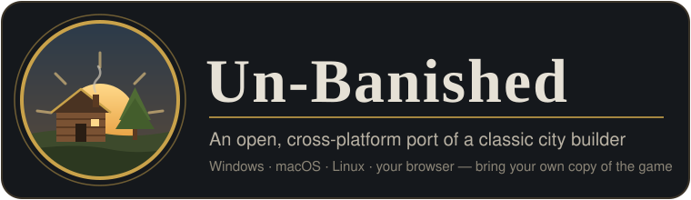
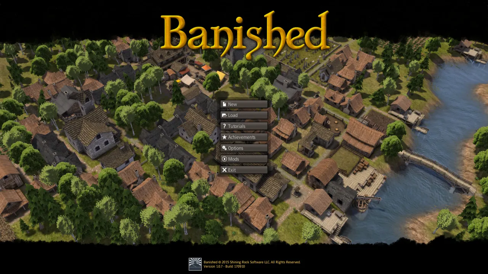
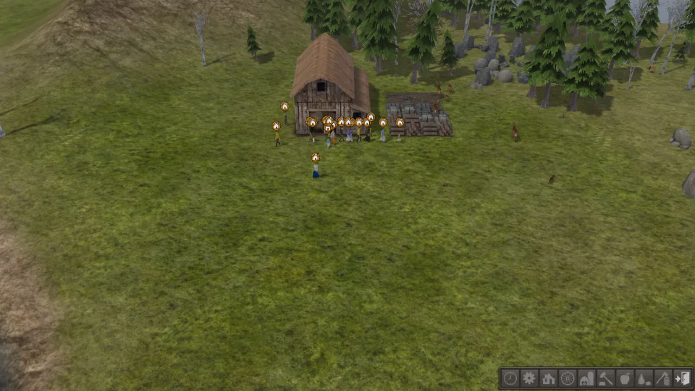
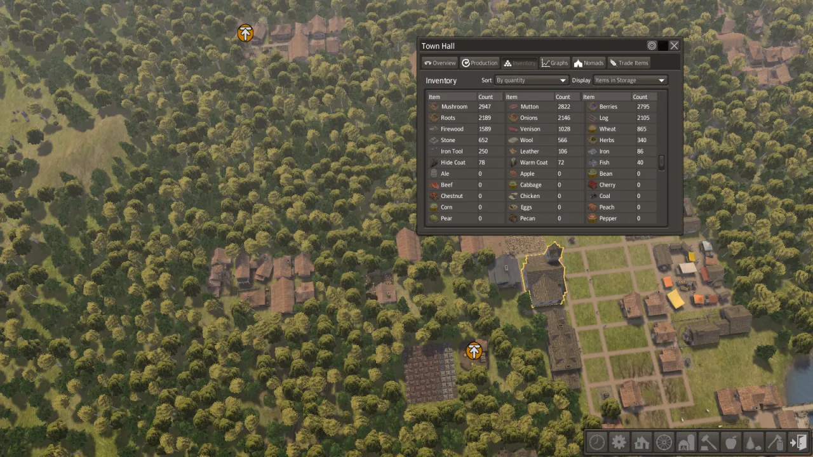

<p align="center"></p>

# Un-Banished setup guide

This guide explains how to install Un-Banished and start playing. It takes about ten minutes.
It also explains where Un-Banished keeps your saves, settings and mods, and what to do when
something goes wrong. To learn what the project is, read the [README](../README.md).

**Setup**

1. [Check what you need](#1-check-what-you-need)
2. [Install the build tools](#2-install-the-build-tools)
3. [Download and build Un-Banished](#3-download-and-build-un-banished)
4. [Find your game data](#4-find-your-game-data)
5. [Play](#5-play)

**Reference**

- [Play in the browser](#play-in-the-browser)
- [Controls](#controls) · [Saves](#saves) · [Settings](#settings) · [Mods](#mods)
- [Command-line options](#command-line-options)
- [Troubleshooting](#troubleshooting)
- [Reporting a difference from the original](#reporting-a-difference-from-the-original)

---

## 1. Check what you need

| You need | Why |
|---|---|
| **Banished 1.0.7** from Steam or GOG | Un-Banished reads the game's art, sound and data from your copy. It includes none of its own. |
| **A graphics card from the last ten years** | Anything with Vulkan, Metal, DirectX 12 or OpenGL ES 3. |
| **About 3 GB of free disk space** | For the build tools and the compiled game. |

### Getting the game files

Banished was released only for Windows. But Un-Banished needs only the game's data files, and
these files work on any system.

- **On Windows**, install the game from Steam or GOG in the normal way. Then go to
  [step 2](#2-install-the-build-tools).
- **On a Mac or a Linux PC**, Steam and GOG do not install a Windows-only game in the normal
  way. Use one of the methods below.

<details>
<summary><strong>Steam: download the Windows files with <code>download_depot</code></strong></summary>

Steam has a hidden console. With the console, you can download the files of any game you own,
for any system. On Steam, Banished has the app number **242920**. Its Windows game files are in
the depot (download package) number **242921**.

1. Open Steam and sign in with the account that owns Banished.
2. Open the Steam console. There are two ways:
   - type `steam://open/console` in the address bar of your web browser, and allow the browser
     to open Steam; or
   - close Steam, and start it again with the `-console` option.

   A **Console** tab then appears in Steam, next to Library, Store and Community.
3. In the box at the bottom of the Console tab, type this and press Enter:
   ```text
   download_depot 242920 242921
   ```
4. Wait a few minutes. Steam shows no progress bar. When the download is complete, the console
   prints a message with the folder where Steam saved the files.
5. That folder contains `WinData`. It is usually:

   | System | Folder |
   |---|---|
   | macOS | `~/Library/Application Support/Steam/Steam.AppBundle/Steam/Contents/MacOS/steamapps/content/app_242920/depot_242921` |
   | Linux | `~/.local/share/Steam/ubuntu12_32/steamapps/content/app_242920/depot_242921` (or under `~/.steam/steam/`) |

   If your folder is different, use the path that the console printed. You can move the folder
   to a simpler place, for example `~/Games/Banished`. Steam does not manage this folder, so
   Steam will not update or delete it.

`tools/extract-assets.sh` already looks in the macOS folder above.

> [!TIP]
> **On Linux, you can also install Banished in the normal way.** In Steam, open **Settings → Compatibility**,
> turn on **Enable Steam Play for all other titles**, and install Banished from your library.
> Steam installs the Windows version under `~/.steam/steam/steamapps/common/Banished`.

</details>

<details>
<summary><strong>GOG: unpack the Windows installer</strong></summary>

GOG sells Banished without copy protection (DRM). So you can download the installer and unpack
the files from it. You do not need to run the installer.

1. Sign in at [gog.com](https://www.gog.com), open **Account → Games**, and click **Banished**.
2. Under **Download offline backup game installers**, choose the **Windows** installer, in
   English or in your language. The file has a name like `setup_banished_1.0.7_….exe`. If GOG
   splits the installer into several files, also download the `.bin` files. Keep all of them in
   the same folder.
3. Install **innoextract**, which unpacks GOG installers:
   - macOS (with [Homebrew](https://brew.sh)): `brew install innoextract`
   - Debian or Ubuntu: `sudo apt install innoextract`
   - Fedora: `sudo dnf install innoextract` · Arch: `sudo pacman -S innoextract`
4. Unpack it into a new folder:
   ```bash
   mkdir -p ~/Games/Banished
   innoextract --gog --output-dir ~/Games/Banished ~/Downloads/setup_banished_*.exe
   ```
5. Look for the `WinData` folder inside `~/Games/Banished`. Some installers put it one level
   lower, in a folder such as `app`. This `WinData` folder is the folder that Un-Banished needs.

If you have **GOG Galaxy** on a Windows PC, you can also install Banished there. Then copy its
`WinData` folder to your Mac or Linux PC.

</details>

**Another method:** install Banished on a Windows PC. Then copy its `WinData` folder to your
computer, with a USB stick or over your network. Un-Banished needs only the four `.pkg` files
(about 165 MB).

## 2. Install the build tools

Un-Banished is written in [Rust](https://www.rust-lang.org/). There are no ready-made downloads
yet. You install Rust once, and Rust builds the game for you. Choose your system:

<details>
<summary><strong>Windows</strong></summary>

1. Download and run **rustup-init.exe** from <https://rustup.rs>.
2. If the installer asks to install the *Visual Studio C++ build tools*, choose yes and keep the
   default settings. Rust needs these tools to build Windows programs.
3. When the installer asks how to install Rust, press **Enter**. This chooses the default.
4. Install **Git** from <https://git-scm.com/download/win>. The default settings are correct.
5. Open a new **PowerShell** or **Terminal** window. Only a new window can find the new tools.

</details>

<details>
<summary><strong>macOS</strong></summary>

1. Open **Terminal** (in Applications → Utilities).
2. Install Apple's command-line tools, which include Git:
   ```bash
   xcode-select --install
   ```
3. Install Rust and accept the default option:
   ```bash
   curl --proto '=https' --tlsv1.2 -sSf https://sh.rustup.rs | sh
   ```
4. Close Terminal and open it again. Only a new window can find the new tools.

</details>

<details>
<summary><strong>Linux</strong></summary>

1. Install a C compiler, Git and the ALSA sound headers. On Debian or Ubuntu:
   ```bash
   sudo apt install build-essential git pkg-config libasound2-dev
   ```
   On Fedora: `sudo dnf install gcc git pkgconf-pkg-config alsa-lib-devel`.
   On Arch: `sudo pacman -S base-devel git alsa-lib`.
2. Install Rust and accept the default option:
   ```bash
   curl --proto '=https' --tlsv1.2 -sSf https://sh.rustup.rs | sh
   ```
3. Open a new terminal. Only a new terminal can find the new tools.
4. Check that your graphics driver supports Vulkan: the command `vulkaninfo --summary` must show
   your graphics card.

</details>

To check the installation, run `cargo --version` in the new terminal. It must print a version
number.

## 3. Download and build Un-Banished

In the terminal, run:

```bash
git clone https://github.com/tanepiper/unbanished.git
cd unbanished
cargo build -p banished-app --release
```

The first build downloads the libraries that Un-Banished uses, and takes a few minutes. Later
builds are much faster. When the build is complete, the game is in this file:

| System | File |
|---|---|
| Windows | `target\release\banished.exe` |
| macOS, Linux | `target/release/banished` |

To update Un-Banished later, run `git pull` in the same folder. Then run the `cargo build`
command again.

## 4. Find your game data

Un-Banished reads four files from your game's `WinData` folder: `data0.pkg`, `data1.pkg`,
`patch0.pkg` and `patch1.pkg`. It only reads them and never changes them.

| Where you got Banished | The `WinData` folder |
|---|---|
| Steam, Windows | `C:\Program Files (x86)\Steam\steamapps\common\Banished\WinData` |
| Steam, macOS | `~/Library/Application Support/Steam/steamapps/common/Banished/WinData` |
| Steam, Linux | `~/.steam/steam/steamapps/common/Banished/WinData` |
| GOG or elsewhere | the folder with Banished's `.exe` files, then `WinData` inside it |

> [!TIP]
> In Steam, right-click **Banished**, then choose **Manage → Browse local files**. Steam opens
> the game's folder.

## 5. Play

There are three ways to start the game. Choose one.

**A. Give it the folder.** This way works on every system:

```bash
# Windows (PowerShell)
target\release\banished.exe "C:\Program Files (x86)\Steam\steamapps\common\Banished\WinData"

# macOS
target/release/banished ~/Library/Application\ Support/Steam/steamapps/common/Banished/WinData

# Linux
target/release/banished ~/.steam/steam/steamapps/common/Banished/WinData
```

**B. Put it next to the game.** Copy `banished.exe` (or `banished`) into your Banished folder,
next to `WinData`. Start it from there, or make a desktop shortcut to it. It then works like the
original program. It finds `WinData` in the same folder, and it uses the same save folder as the
original.

**C. Start it from the source folder.** This way is for contributors. Copy your game data into
the project once. Then start the game with `cargo run`:

```bash
tools/extract-assets.sh          # finds the usual Steam folders
cargo run -p banished-app --release
```

If your copy of Banished is in another place, run
`BANISHED_DIR="/path/to/Banished" tools/extract-assets.sh`. `BANISHED_DIR` is the folder that
*contains* `WinData`. The script needs Python 3 and a `bash` shell. On Windows, use Git Bash.
The script copies the files into `game-data/`. Git ignores this folder, so the files are never
committed.

The game then starts like the original. First you see the splash screen and the loading screen.
Then you see the main menu, with its music and a 3D town scene. New Game, Load, Tutorials,
Achievements, Mods and Options all work.

<p align="center">
  
</p>

Choose **New**, keep the default settings, and press **OK**. Your settlers arrive next to their
first stockpile:

<p align="center">
  
</p>

Click a building or a citizen to open its window. This is the Town Hall in a large town:

<p align="center">
  
</p>

---

## Play in the browser

The browser version is the same game, built for WebAssembly. The page reads your game files on
your computer and does not upload them.

**The simple way:** open the [Play page](https://tanepiper.github.io/unbanished/play) on the
website. You do not need to install anything. Press **Start the game**, then follow steps 2 and 3
below.

**To run the browser version yourself**, for example to test a change, you need two more tools.
Install them once:

```bash
rustup target add wasm32-unknown-unknown
cargo install trunk
```

Then start the local server from the source folder:

```bash
tools/dev-web.sh --app game --release
```

1. Open <http://127.0.0.1:8733/> in Chrome or Edge.
2. A **Load your game data** panel appears at the top left. Press **Choose files**. Select
   **all four** `.pkg` files from `WinData` at the same time: `data0.pkg`, `data1.pkg`,
   `patch0.pkg` and `patch1.pkg`. To select several files, hold Ctrl (Cmd on a Mac).
3. Click the game once. Then the game receives your keyboard input, and it can play sound.

If you ran `tools/extract-assets.sh`, you do not need to choose files. Open
<http://127.0.0.1:8733/?data=/game-data/> instead. This address loads your copied game data.

**Good to know**
- It uses WebGPU when the browser supports it, and WebGL 2 when it does not.
- The browser keeps your saves, settings and mods in its storage for this page (see below). If
  you clear the site's data, you delete them.
- `tools/dev-web.sh` is a server for your own computer only. Do not make it available on the
  internet.

## Controls

These are the default controls of the original game. You can change any of them in
**Options → Input**.

### Camera

| Action | Default |
|---|---|
| Move | **W A S D**, or move the pointer to the edge of the screen (Options → Game → Edge Scroll) |
| Rotate | **Q** / **E**, or hold the **middle mouse button** and move the mouse |
| Zoom | **Mouse wheel**, or **Insert** / **Delete** |
| Tilt | **Page Up** / **Page Down** |
| Camera presets | **Z**, **X**, **C**, **V**, **B** |

### Game

| Action | Default |
|---|---|
| Select a building or citizen, place, confirm | **Left click** |
| Cancel a drag, or put the current tool away | **Right click** / **Esc** |
| Pause and resume | **Space** |
| Toolbar buttons | **F1 – F9** |
| Tools in the open toolbar menu | **1 – 9**, **0** |
| Turn the building being placed | the *Structure Left / Right* keys (see Options → Input) |
| Road tool: straight-line paths | hold the *Path Method* key |
| Screenshot without the interface | **Print Screen** |
| Screenshot with the interface | **Scroll Lock** |

On the desktop, screenshots are saved in `Documents/Banished/Screenshots`. In the browser, they
are downloaded.

## Saves

| Version | Where saves live |
|---|---|
| Desktop | `Documents/Banished/Save/` — the same folder as the original game |
| Browser | the browser's storage (IndexedDB) for the page |

On the desktop, Un-Banished uses the same save format and the same folder as Banished. So towns
that you saved in the original game appear in the Load dialog. Autosaves work as in the original
(**Options → Game**). On Windows, the folder is `%USERPROFILE%\Documents\Banished\Save`. If you
moved your Documents folder to another place, Un-Banished does not follow it.

To keep your saves in another place, set `BANISHED_USER_DIR` to a folder. Un-Banished then uses
the `Save` folder inside it.

## Settings

The Options dialog saves its values (video, audio, game options and key bindings) in a settings
file:

| System | File |
|---|---|
| Windows | `%APPDATA%\banished-wasm\settings.txt` |
| macOS | `~/Library/Application Support/banished-wasm/settings.txt` |
| Linux | `$XDG_CONFIG_HOME/banished-wasm/settings.txt` (usually `~/.config/…`) |
| Browser | the browser's local storage for the page |

To return to the default settings, delete this file. To use a different settings file, set
`BANISHED_SETTINGS` to its path.

## Mods

Un-Banished loads mods made with the BanishedKit (`.pkm` files), as Banished 1.0.7 does.

- **Desktop:** put the `.pkm` files in the `WinData` folder that Un-Banished reads. Then open
  **Mods** in the main menu, select the mods you want, set their order, and press OK. The game
  loads its data again, with the mods.
- **Browser:** select the `.pkm` files together with the four `.pkg` files. You can also drag
  them onto the page at any time. Then turn them on in the **Mods** menu. The browser keeps them
  in its storage.

As in the original, the Mods menu marks two mods as conflicting when they change the same files.
Also as in the original, you cannot earn achievements while mods are turned on.

## Command-line options

To play, you need at most one argument: the `WinData` folder (`banished PATH`). The other
commands draw one picture and then stop. They are for testing, and for the screenshots in these
documents:

| Command | Effect |
|---|---|
| `banished PATH` | play, reading the game data from this `WinData` folder |
| `banished --boot-capture FILE.png SECONDS` | start the game, run it for `SECONDS` and save that frame |
| `banished --capture FILE.png [options]` | generate a map and save a picture of it |

Options for the captures: `--seed N`, `--terrain NAME`, `--size 0|1|2`, `--month 0..11`,
`--view overview`, `--ui-scale PERCENT` and `--setting KEY=VALUE` (a stored setting by its
original name, such as `VideoReflectionDetail=2`). Captures do not use your saved settings.

Environment variables: `BANISHED_USER_DIR` (the folder that holds `Save`), `BANISHED_SETTINGS`
(the settings file), `RUST_LOG` (how much detail the log shows, for example `RUST_LOG=debug`).

## Troubleshooting

**"No .pkg files found."** Un-Banished cannot find the game data. Give the `WinData` folder on
the command line, put the program next to `WinData`, or run `tools/extract-assets.sh`.

**`tools/extract-assets.sh` says that it cannot find Banished.** Set `BANISHED_DIR` to the folder
that contains `WinData`, and run the script again.

**The browser page still shows "Load your game data".** Select all four `.pkg` files at the same
time. If the page reports a parse error, one of the files is damaged or incomplete. In Steam,
right-click Banished, choose **Properties → Installed Files → Verify integrity of game files**,
and try again.

**The window is black, or a graphics error appears at start.** Update your graphics drivers. On
Linux, check that the Vulkan drivers are installed: `vulkaninfo` must show your graphics card.

**There is no sound in the browser.** Browsers play sound only after you click or type on the
page. Click the game once.

**After an update, my Un-Banished settings look wrong.** Delete the settings file (see
[Settings](#settings)).

## Reporting a difference from the original

The goal of Un-Banished is to work exactly like Banished 1.0.7. If something looks, sounds or
works differently, or does not work, please
[open an issue](https://github.com/tanepiper/unbanished/issues/new/choose). The forms there ask
for the information we need:

- **Parity difference:** what the original does, what Un-Banished does, and how to see it.
- **Bug report:** something broken or impossible to do.
- **Performance problem:** stutters, slowdowns, long loads.

Screenshots or a short video from both games are very useful. Do not attach the game's own files
(`.pkg`, `.exe`, or extracted art or sound).

[DEVIATIONS.md](DEVIATIONS.md) lists the known, intentional differences.
[PARITY-AUDIT.md](PARITY-AUDIT.md) shows what has been checked.
