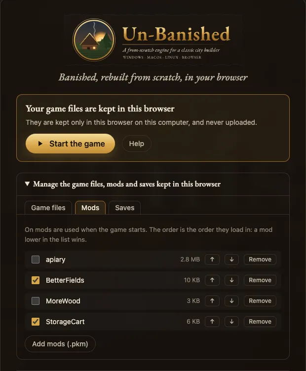
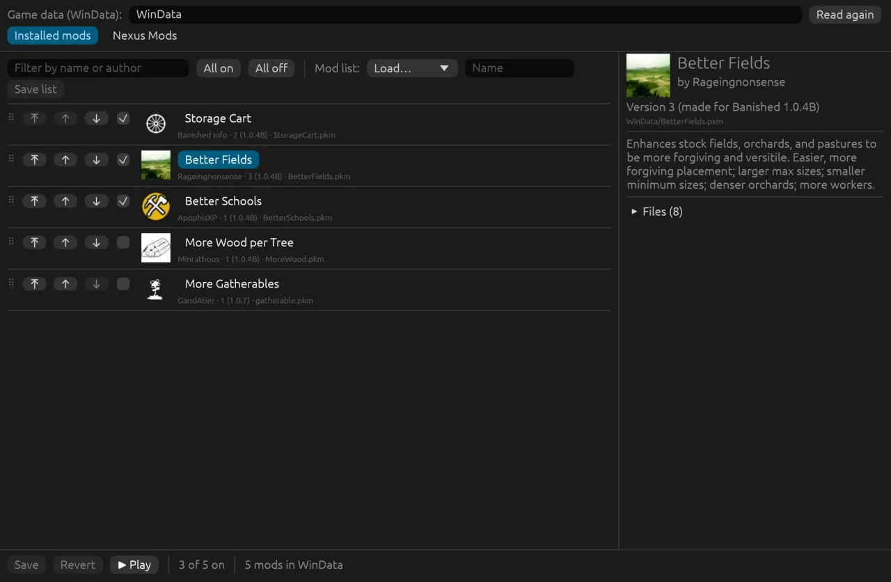
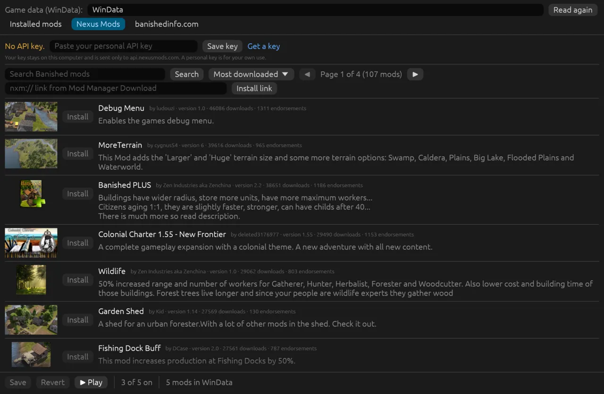
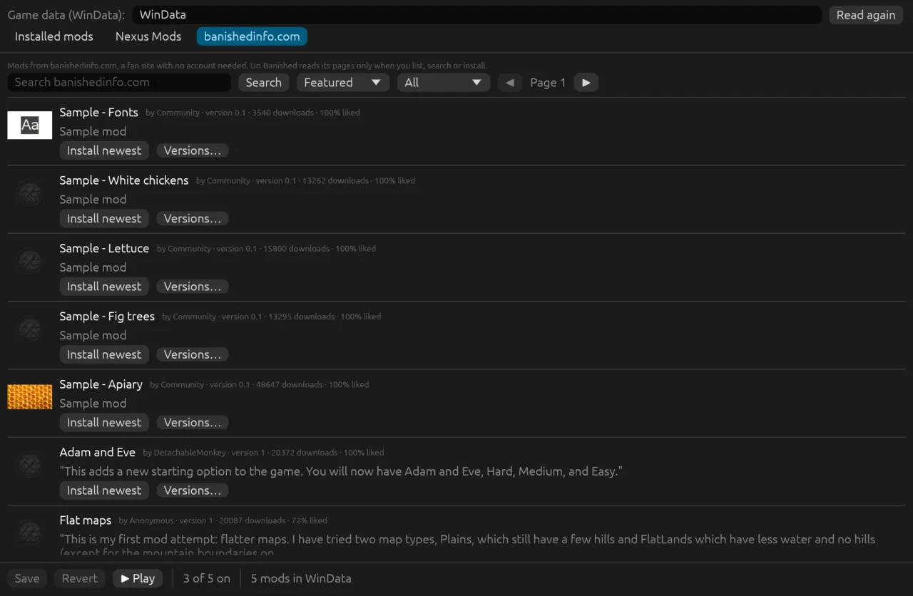
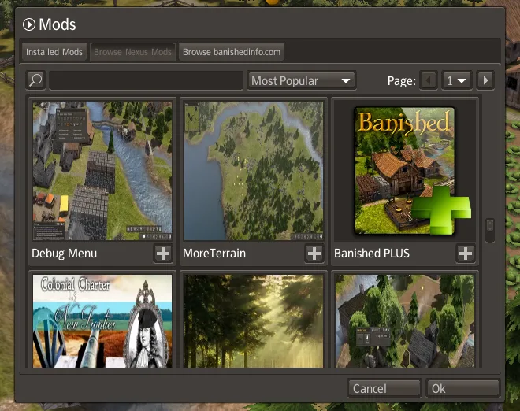
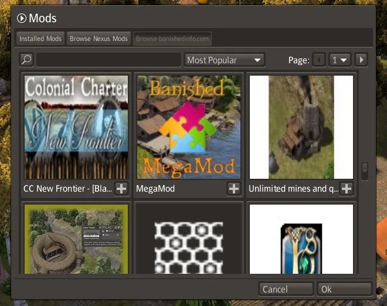

<p align="center"></p>

# Un-Banished setup guide

This guide explains how to install Un-Banished and start playing. It takes about ten minutes.
It also explains where Un-Banished keeps your saves, settings and mods, and what to do when
something goes wrong. To learn what the project is, read the [README](../README.md).

**Setup**

1. [Check what you need](#1-check-what-you-need)
2. [Install the build tools](#2-install-the-build-tools)
3. [Download and build Un-Banished](#3-download-and-build-un-banished)
4. [Find your game data](#4-find-your-game-data)
5. [Play](#5-play)

**Reference**

- [Play in the browser](#play-in-the-browser)
- [Controls](#controls) · [Saves](#saves) · [Settings](#settings) · [Mods](#mods)
- [Command-line options](#command-line-options)
- [Troubleshooting](#troubleshooting)
- [Reporting a difference from the original](#reporting-a-difference-from-the-original)

---

## 1. Check what you need

| You need | Why |
|---|---|
| **Banished 1.0.7** from Steam or GOG | Un-Banished reads the game's art, sound and data from your copy. It includes none of its own. |
| **A graphics card from the last ten years** | Anything with Vulkan, Metal, DirectX 12 or OpenGL ES 3. |
| **About 3 GB of free disk space** | For the build tools and the compiled game. |

### Getting the game files

Banished was released only for Windows. But Un-Banished needs only the game's data files, and
these files work on any system.

- **On Windows**, install the game from Steam or GOG in the normal way. Then go to
  [step 2](#2-install-the-build-tools).
- **On a Mac or a Linux PC**, Steam and GOG do not install a Windows-only game in the normal
  way. Use one of the methods below.

<details>
<summary><strong>Steam: download the Windows files with <code>download_depot</code></strong></summary>

Steam has a hidden console. With the console, you can download the files of any game you own,
for any system. On Steam, Banished has the app number **242920**. Its Windows game files are in
the depot (download package) number **242921**.

1. Open Steam and sign in with the account that owns Banished.
2. Open the Steam console. There are two ways:
   - type `steam://open/console` in the address bar of your web browser, and allow the browser
     to open Steam; or
   - close Steam, and start it again with the `-console` option.

   A **Console** tab then appears in Steam, next to Library, Store and Community.
3. In the box at the bottom of the Console tab, type this and press Enter:
   ```text
   download_depot 242920 242921
   ```
4. Wait a few minutes. Steam shows no progress bar. When the download is complete, the console
   prints a message with the folder where Steam saved the files.
5. That folder contains `WinData`. It is usually:

   | System | Folder |
   |---|---|
   | macOS | `~/Library/Application Support/Steam/Steam.AppBundle/Steam/Contents/MacOS/steamapps/content/app_242920/depot_242921` |
   | Linux | `~/.local/share/Steam/ubuntu12_32/steamapps/content/app_242920/depot_242921` (or under `~/.steam/steam/`) |

   If your folder is different, use the path that the console printed. You can move the folder
   to a simpler place, for example `~/Games/Banished`. Steam does not manage this folder, so
   Steam will not update or delete it.

`tools/extract-assets.sh` already looks in the macOS folder above.

> [!TIP]
> **On Linux, you can also install Banished in the normal way.** In Steam, open **Settings → Compatibility**,
> turn on **Enable Steam Play for all other titles**, and install Banished from your library.
> Steam installs the Windows version under `~/.steam/steam/steamapps/common/Banished`.

</details>

<details>
<summary><strong>GOG: unpack the Windows installer</strong></summary>

GOG sells Banished without copy protection (DRM). So you can download the installer and unpack
the files from it. You do not need to run the installer.

1. Sign in at [gog.com](https://www.gog.com), open **Account → Games**, and click **Banished**.
2. Under **Download offline backup game installers**, choose the **Windows** installer, in
   English or in your language. The file has a name like `setup_banished_1.0.7_….exe`. If GOG
   splits the installer into several files, also download the `.bin` files. Keep all of them in
   the same folder.
3. Install **innoextract**, which unpacks GOG installers:
   - macOS (with [Homebrew](https://brew.sh)): `brew install innoextract`
   - Debian or Ubuntu: `sudo apt install innoextract`
   - Fedora: `sudo dnf install innoextract` · Arch: `sudo pacman -S innoextract`
4. Unpack it into a new folder:
   ```bash
   mkdir -p ~/Games/Banished
   innoextract --gog --output-dir ~/Games/Banished ~/Downloads/setup_banished_*.exe
   ```
5. Look for the `WinData` folder inside `~/Games/Banished`. Some installers put it one level
   lower, in a folder such as `app`. This `WinData` folder is the folder that Un-Banished needs.

If you have **GOG Galaxy** on a Windows PC, you can also install Banished there. Then copy its
`WinData` folder to your Mac or Linux PC.

</details>

**Another method:** install Banished on a Windows PC. Then copy its `WinData` folder to your
computer, with a USB stick or over your network. Un-Banished needs only the four `.pkg` files
(about 165 MB).

## 2. Install the build tools

Un-Banished is written in [Rust](https://www.rust-lang.org/). There are no ready-made downloads
yet. You install Rust once, and Rust builds the game for you. Choose your system:

<details>
<summary><strong>Windows</strong></summary>

1. Download and run **rustup-init.exe** from <https://rustup.rs>.
2. If the installer asks to install the *Visual Studio C++ build tools*, choose yes and keep the
   default settings. Rust needs these tools to build Windows programs.
3. When the installer asks how to install Rust, press **Enter**. This chooses the default.
4. Install **Git** from <https://git-scm.com/download/win>. The default settings are correct.
5. Open a new **PowerShell** or **Terminal** window. Only a new window can find the new tools.

</details>

<details>
<summary><strong>macOS</strong></summary>

1. Open **Terminal** (in Applications → Utilities).
2. Install Apple's command-line tools, which include Git:
   ```bash
   xcode-select --install
   ```
3. Install Rust and accept the default option:
   ```bash
   curl --proto '=https' --tlsv1.2 -sSf https://sh.rustup.rs | sh
   ```
4. Close Terminal and open it again. Only a new window can find the new tools.

</details>

<details>
<summary><strong>Linux</strong></summary>

1. Install a C compiler, Git and the ALSA sound headers. On Debian or Ubuntu:
   ```bash
   sudo apt install build-essential git pkg-config libasound2-dev
   ```
   On Fedora: `sudo dnf install gcc git pkgconf-pkg-config alsa-lib-devel`.
   On Arch: `sudo pacman -S base-devel git alsa-lib`.
2. Install Rust and accept the default option:
   ```bash
   curl --proto '=https' --tlsv1.2 -sSf https://sh.rustup.rs | sh
   ```
3. Open a new terminal. Only a new terminal can find the new tools.
4. Check that your graphics driver supports Vulkan: the command `vulkaninfo --summary` must show
   your graphics card.

</details>

To check the installation, run `cargo --version` in the new terminal. It must print a version
number.

## 3. Download and build Un-Banished

In the terminal, run:

```bash
git clone https://github.com/tanepiper/unbanished.git
cd unbanished
cargo build -p banished-app --release
```

The first build downloads the libraries that Un-Banished uses, and takes a few minutes. Later
builds are much faster. When the build is complete, the game is in this file:

| System | File |
|---|---|
| Windows | `target\release\banished.exe` |
| macOS, Linux | `target/release/banished` |

To update Un-Banished later, run `git pull` in the same folder. Then run the `cargo build`
command again.

## 4. Find your game data

Un-Banished reads four files from your game's `WinData` folder: `data0.pkg`, `data1.pkg`,
`patch0.pkg` and `patch1.pkg`. It only reads them and never changes them.

| Where you got Banished | The `WinData` folder |
|---|---|
| Steam, Windows | `C:\Program Files (x86)\Steam\steamapps\common\Banished\WinData` |
| Steam, macOS | `~/Library/Application Support/Steam/steamapps/common/Banished/WinData` |
| Steam, Linux | `~/.steam/steam/steamapps/common/Banished/WinData` |
| GOG or elsewhere | the folder with Banished's `.exe` files, then `WinData` inside it |

> [!TIP]
> In Steam, right-click **Banished**, then choose **Manage → Browse local files**. Steam opens
> the game's folder.

## 5. Play

There are three ways to start the game. Choose one.

**A. Give it the folder.** This way works on every system:

```bash
# Windows (PowerShell)
target\release\banished.exe "C:\Program Files (x86)\Steam\steamapps\common\Banished\WinData"

# macOS
target/release/banished ~/Library/Application\ Support/Steam/steamapps/common/Banished/WinData

# Linux
target/release/banished ~/.steam/steam/steamapps/common/Banished/WinData
```

**B. Put it next to the game.** Copy `banished.exe` (or `banished`) into your Banished folder,
next to `WinData`. Start it from there, or make a desktop shortcut to it. It then works like the
original program. It finds `WinData` in the same folder, and it uses the same save folder as the
original.

**C. Start it from the source folder.** This way is for contributors. Copy your game data into
the project once. Then start the game with `cargo run`:

```bash
tools/extract-assets.sh          # finds the usual Steam folders
cargo run -p banished-app --release
```

If your copy of Banished is in another place, run
`BANISHED_DIR="/path/to/Banished" tools/extract-assets.sh`. `BANISHED_DIR` is the folder that
*contains* `WinData`. The script needs Python 3 and a `bash` shell. On Windows, use Git Bash.
The script copies the files into `game-data/`. Git ignores this folder, so the files are never
committed.

The game then starts like the original. First you see the splash screen and the loading screen.
Then you see the main menu, with its music and a 3D town scene. New Game, Load, Tutorials,
Achievements, Mods and Options all work.

<p align="center">
  
</p>

Choose **New**, keep the default settings, and press **OK**. Your settlers arrive next to their
first stockpile:

<p align="center">
  
</p>

Click a building or a citizen to open its window. This is the Town Hall in a large town:

<p align="center">
  
</p>

---

## Play in the browser

The browser version is the same game, built for WebAssembly. The page reads your game files on
your computer and does not upload them.

**The simple way:** open the [Play page](https://tanepiper.github.io/unbanished/play) on the
website. You do not need to install anything. Press **Start the game**, then follow steps 2 and 3
below.

**To run the browser version yourself**, for example to test a change, you need two more tools.
Install them once:

```bash
rustup target add wasm32-unknown-unknown
cargo install trunk
```

Then start the local server from the source folder:

```bash
tools/dev-web.sh --app game --release
```

1. Open <http://127.0.0.1:8733/> in Chrome, Edge or Firefox.
2. The loading screen appears. Press **Choose files**. Select
   **all four** `.pkg` files from `WinData` at the same time: `data0.pkg`, `data1.pkg`,
   `patch0.pkg` and `patch1.pkg`. To select several files, hold Ctrl (Cmd on a Mac).
3. Click the game once. Then the game receives your keyboard input, and it can play sound.

**Next time.** The game keeps the four game files in this browser, so you choose them only
once (uncheck **Keep them in this browser** if you do not want that). When you open the game
again, the start page does not show the steps. It shows **Start the game**, a **Help** button
that shows the steps again, and a manager for what the browser keeps, with three tabs:
- **Game files:** the kept files and their sizes. **Forget the game files** removes them; then
  you choose them again.
- **Mods:** turn each mod on or off, and move it up or down. The order is the order the mods load
  in: a mod lower in the list wins. **Remove** deletes a mod; **Add mods (.pkm)** adds more.
- **Saves:** your saves, newest first. **Download** keeps a copy on your computer, **Delete**
  removes a save, and **Import saves (.sav)** adds saves from the desktop version or the
  original game.

The game reads these when the page opens, so the page reloads after each change.

<p align="center">
  
</p>

The files are kept only in this browser on this computer, in the site's own storage, and are
never uploaded. Clearing the site's data in the browser removes them too, with the saves.

If you ran `tools/extract-assets.sh`, you do not need to choose files. Open
<http://127.0.0.1:8733/?data=/game-data/> instead. This address loads your copied game data.

**Full screen, resolution and frame rate.** In the game's Options:
- **Fullscreen** shows the game full screen. The browser starts the game in its page, so this
  box starts unchecked; check it to go full screen, and press Esc to leave. On the Play page, the
  **Full screen** button below the game does the same.
- **Resolution** draws the 3D world at 100 %, 75 % or 50 % of the page's size. A lower value is
  faster on slow computers, tablets and phones; the menus and text stay sharp.
- **Refresh rate** limits the frames per second: 30, 60, 90 or 120. A lower value saves battery
  and keeps devices cooler.

**Install as an app.** In Chrome or Edge, the address bar offers to install Un-Banished (on
Android: the browser menu, then **Install app** or **Add to home screen**). It then opens in a
window of its own, and starts without an internet connection. Your game files, saves and mods
stay in the browser as before.

**Sharp on every screen.** On screens with a high pixel density and a fractional scale (4K
monitors, tablets, Samsung DeX), the menus and text are drawn on whole screen pixels, so they stay
sharp.

**Good to know**
- It uses WebGPU when the browser supports it, and WebGL 2 when it does not.
- The browser keeps your saves, settings and mods in its storage for this page (see below). If
  you clear the site's data, you delete them.
- `tools/dev-web.sh` is a server for your own computer only. Do not make it available on the
  internet.

## Controls

These are the default controls of the original game. You can change any of them in
**Options → Input**.

### Camera

| Action | Default |
|---|---|
| Move | **W A S D**, or move the pointer to the edge of the screen (Options → Game → Edge Scroll) |
| Rotate | **Q** / **E**, or hold the **middle mouse button** and move the mouse |
| Zoom | **Mouse wheel**, or **Insert** / **Delete** |
| Tilt | **Page Up** / **Page Down** |
| Camera presets | **Z**, **X**, **C**, **V**, **B** |

### Game

| Action | Default |
|---|---|
| Select a building or citizen, place, confirm | **Left click** |
| Cancel a drag, or put the current tool away | **Right click** / **Esc** |
| Pause and resume | **Space** |
| Toolbar buttons | **F1 – F9** |
| Tools in the open toolbar menu | **1 – 9**, **0** |
| Turn the building being placed | the *Structure Left / Right* keys (see Options → Input) |
| Road tool: straight-line paths | hold the *Path Method* key |
| Screenshot without the interface | **Print Screen** |
| Screenshot with the interface | **Scroll Lock** |

On the desktop, screenshots are saved in `Documents/Banished/Screenshots`. In the browser, they
are downloaded.

## Saves

| Version | Where saves live |
|---|---|
| Desktop | `Documents/Banished/Save/` — the same folder as the original game |
| Browser | the browser's storage (IndexedDB) for the page |

On the desktop, Un-Banished uses the same save format and the same folder as Banished. So towns
that you saved in the original game appear in the Load dialog. Autosaves work as in the original
(**Options → Game**). On Windows, the folder is `%USERPROFILE%\Documents\Banished\Save`. If you
moved your Documents folder to another place, Un-Banished does not follow it.

To keep your saves in another place, set `BANISHED_USER_DIR` to a folder. Un-Banished then uses
the `Save` folder inside it.

## Settings

The Options dialog saves its values (video, audio, game options and key bindings) in a settings
file:

| System | File |
|---|---|
| Windows | `%APPDATA%\banished-wasm\settings.txt` |
| macOS | `~/Library/Application Support/banished-wasm/settings.txt` |
| Linux | `$XDG_CONFIG_HOME/banished-wasm/settings.txt` (usually `~/.config/…`) |
| Browser | the browser's local storage for the page |

To return to the default settings, delete this file. To use a different settings file, set
`BANISHED_SETTINGS` to its path.

## Multiplayer

Not in the original game. Several players can build one town together, each with their own copy
of Banished and the same version of Un-Banished and the same mods. One player runs the relay
(`cargo build -p banished-relay --release`, then `target/release/banished-relay`; port 7780).
Everybody presses **Multiplayer** in the main menu and enters the relay's address. The host
presses **Host** and gives the room code to the others, who press **Join**. Then the host presses
**Start** and chooses a save.

[Multiplayer](guide/MULTIPLAYER.md) explains every step with pictures: the relay on a home
network or the internet, what is shared, what happens when a player leaves, the browser, and
what to do when something goes wrong.

## Mods

Un-Banished loads mods made with the BanishedKit (`.pkm` files), as Banished 1.0.7 does.

- **Desktop:** put the `.pkm` files in the `WinData` folder that Un-Banished reads. Then open
  **Mods** in the main menu, select the mods you want, set their order, and press OK. The game
  loads its data again, with the mods.
- **Browser:** select the `.pkm` files together with the four `.pkg` files. You can also drag
  them onto the page at any time. Then turn them on in the **Mods** menu. The browser keeps them
  in its storage.

As in the original, the Mods menu marks two mods as conflicting when they change the same files.
Also as in the original, you cannot earn achievements while mods are turned on.

### The mod manager

`banished-mods` is a small desktop program, beside the game, to choose your mods before you
play. It does what the Mods menu does, plus a few things the menu cannot:

- turn mods on and off, all at once or one by one, and filter the list by name or author;
- change the order: drag a mod, or use ⤒ (to the top), ↑ and ↓. The first mod in the list wins
  when two mods change the same file, and the list marks such conflicts;
- see a mod's details: its description, the mods it shares files with, and its files;
- keep **mod lists**: save the mods that are on, and their order, under a name, and load the
  list again later;
- search and install mods from Nexus Mods (the same key as below; you can also paste the key
  in the program, and it is saved in the settings file);
- list, search and install mods from banishedinfo.com, with no account;
- **Play**: save, then start Un-Banished with the same game data.

Start it from the repository:

```bash
cargo run --release -p banished-modmanager -- path/to/WinData
```

Without a folder it uses `WinData` beside the program, then the folder you used last. **Save**
writes the same settings the game's Mods menu writes, so the game uses them when it starts.
Close the game before you change mods here: the game writes its settings file when it closes, and
would undo the changes. Mod lists are text files in `Documents/Banished/ModLists`.

It has three tabs: **Installed mods** (your mods, their order and the mod lists), **Nexus Mods**
and **banishedinfo.com** (each site's mods, with previews; **Install** puts a mod in `WinData`).

<p align="center">
  
</p>
<p align="center">
  
  
</p>

### Mods from Nexus Mods

Banished's Steam version has a **Browse** tab in the Mods menu, for the Steam Workshop.
Un-Banished has a Browse tab for each mod site instead: **Browse Nexus Mods** and, on the
desktop, **Browse banishedinfo.com**. Both are shown by default. To hide one, add
`ModBrowseNexus=false` or `ModBrowseBanishedInfo=false` to the [settings file](#settings).

To reach them: on the main menu (or in the pause menu during a game), press **Mods**, then the
tab at the top of the window. Each tab shows the site's most popular mods as tiles with a
preview; type in the box and press the magnifying glass to search, choose an order in the list,
and turn the pages with the arrows. **+** on a tile installs that mod.

<p align="center">
  
  
</p>

You can search and look at [Nexus Mods](https://www.nexusmods.com/games/banished/mods) without an
account. To install from it, give Un-Banished your own Nexus Mods API key:

1. Sign in on nexusmods.com. Open your account settings, then **API Keys**, and copy your
   personal API key. Treat it like a password: do not share it.
2. Give the key to Un-Banished in one of these ways:
   - add a line `NexusApiKey=YOUR_KEY` to the [settings file](#settings);
   - or, on the desktop, set the environment variable `BANISHED_NEXUS_API_KEY`. It wins over
     the settings file;
   - or, in the browser, open the developer console on the game page and run
     `localStorage.setItem('banished-wasm.settings', (localStorage.getItem('banished-wasm.settings') || '') + '\nNexusApiKey=YOUR_KEY')`,
     then reload the page.
3. Open **Mods** and choose **Browse Nexus Mods**. Search by name, or sort by **Most Popular**
   (most downloads), **Most Recent** (recently updated) or **Subscribed** (the mods you
   installed from Nexus Mods).
4. Press **+** on a mod to install it:
   - With a **Premium** account, Un-Banished downloads the mod's main file and installs it.
   - Without Premium, Nexus Mods only allows downloads from its website. Un-Banished opens the
     mod's files page. Press **Mod Manager Download** there and copy the `nxm://` link that
     your browser offers to open. Paste the link into the search box in the Browse tab and
     press the search button. Un-Banished installs that file.
5. When the download is done, press the reload button that appears ("Mod updates are ready"),
   or open the game again later. Then turn the new mod on in **Installed Mods**.

Good to know:

- Un-Banished installs the `.pkm` files from `.zip` downloads, and plain `.pkm` files. Some mods
  come as `.7z` or `.rar` files. For those, download the file from the website, unpack it, and
  put the `.pkm` file in `WinData` yourself.
- The previews of the mods (PNG, JPEG or WebP pictures) show on the desktop. The browser version
  shows the list without previews.
- The key stays on your computer, in the settings file or in the browser. Un-Banished sends it
  only to `api.nexusmods.com`, and only when you search, sign in or install.
- Un-Banished is not yet a registered Nexus Mods application. Until it is, a personal key is
  for your own use, as the Nexus Mods rules say.

The same works from the command line, with the same key:

```bash
cargo run --release -p banished-cli -- nexus search terrain
```

```bash
cargo run --release -p banished-cli -- nexus install 19 --to path/to/WinData
```

`nexus whoami` shows the account the key belongs to, `nexus files MOD_ID` lists a mod's files,
and `nexus install 'nxm://…'` installs from a Mod Manager Download link.


### Mods from banishedinfo.com (desktop)

[banishedinfo.com](https://banishedinfo.com/mods/browse) is a fan site with many Banished mods.
It needs no account. Un-Banished can list, search and install its mods on the desktop. The
browser version cannot, because the site does not allow other web pages to read it.

- **Mod manager:** open the **banishedinfo.com** tab. Choose an order (Featured, Most
  downloaded, Popular today, Newest) and a section, or search. **Install newest** installs the
  newest version; **Versions…** lists the others.
- **Game:** open **Mods** and choose **Browse banishedinfo.com**. **Most Popular** is the most
  downloaded, **Most Recent** the newest, and **+** installs the newest version.
- **Command line:**

```bash
cargo run --release -p banished-cli -- banishedinfo list --sort downloads
```

```bash
cargo run --release -p banished-cli -- banishedinfo install 34 --to path/to/WinData
```

Un-Banished reads the site only when you list, search or install, and it names itself in each
request. As for Nexus Mods, it installs `.zip` and `.pkm` downloads; unpack `.7z` and `.rar`
files yourself.

## Command-line options

To play, you need at most one argument: the `WinData` folder (`banished PATH`). The other
commands run without a window and then stop. They are for testing, and for the screenshots and
videos in these documents:

| Command | Effect |
|---|---|
| `banished PATH` | play, reading the game data from this `WinData` folder |
| `banished --version` | show the Un-Banished version (see [Version](#version)) and stop |
| `banished --record FILE …` | record every command of the next game you load from a save (add it to any of the other commands, or to `banished PATH`) |
| `banished --replay SAVE FILE` | play a recording again from its save, and check that the game comes out the same |
| `banished --sim-digest SAVE` | run a save and print checksums of the game state, to compare with the browser version |
| `banished --boot-capture FILE.png SECONDS` | start the game, run it for `SECONDS` and save that frame |
| `banished --capture FILE.png [options]` | generate a map and save a picture of it |

Options for the captures: `--seed N`, `--terrain NAME`, `--size 0|1|2`, `--month 0..11`,
`--view overview`, `--ui-scale PERCENT` and `--setting KEY=VALUE` (a stored setting by its
original name, such as `VideoReflectionDetail=2`). Captures do not use your saved settings.
`--boot-capture` can also click, drag, type, move the camera and take screenshots at given
times; the [game's README](../apps/game/README.md#headless-captures) lists every option, and
[Recording videos](develop/VIDEOS.md) shows how to use them.

The other programs:

| Program | What it is |
|---|---|
| `banished-mods [PATH]` | the [mod manager](#the-mod-manager) |
| `banished-cli nexus …`, `banished-cli banishedinfo …` | search and install mods from the command line (see [Mods](#mods) and the [CLI README](../apps/cli/README.md)) |
| `banished-relay [ADDRESS]` | the multiplayer relay (see [Multiplayer](#multiplayer) and the [relay's README](../apps/relay/README.md)) |

Environment variables: `BANISHED_USER_DIR` (the folder that holds `Save`), `BANISHED_SETTINGS`
(the settings file), `RUST_LOG` (how much detail the log shows, for example `RUST_LOG=debug`),
`BANISHED_PROFILE=1` (logs slow frames and frame-time summaries; in the browser, add `?profile`
to the address), `BANISHED_THREADS=N` (how many threads loading uses; the default is one per
CPU core, and 1 loads everything on one thread), `BANISHED_NEXUS_API_KEY` (your Nexus Mods API
key; see [Mods from Nexus Mods](#mods-from-nexus-mods)). See
[PERFORMANCE.md](PERFORMANCE.md).

## Version

Un-Banished has its own version number, for example `0.2.0-1382712`. The first part is the
release: a released version, or the next release while it is in development (see
[CHANGELOG.md](../CHANGELOG.md)). The second part is the build: the first seven characters of the git commit the program
was built from. `-dirty` at the end means that the program was built with changes that were not
committed. `unknown` means that the build could not be found, for example in a build from a
source archive without git.

You can see the version in these places:

- `banished --version` shows it, for example `Un-Banished 0.2.0-1382712`.
- The first line of the log, when the game starts.
- In the browser: at the foot of the loading screen, and in the
  browser's console.
- On the website, at the bottom of the pages.

The main menu shows "Version 1.0.7 - Build 170910". That is the version of Banished, from the
game data. It does not change. Give both versions when you report a problem.

## Troubleshooting

**"No .pkg files found."** Un-Banished cannot find the game data. Give the `WinData` folder on
the command line, put the program next to `WinData`, or run `tools/extract-assets.sh`.

**`tools/extract-assets.sh` says that it cannot find Banished.** Set `BANISHED_DIR` to the folder
that contains `WinData`, and run the script again.

**The browser page still shows the loading screen.** Select all four `.pkg` files at the same
time. If the page reports a parse error, one of the files is damaged or incomplete. In Steam,
right-click Banished, choose **Properties → Installed Files → Verify integrity of game files**,
and try again.

**The window is black, or a graphics error appears at start.** Update your graphics drivers. On
Linux, check that the Vulkan drivers are installed: `vulkaninfo` must show your graphics card.

**There is no sound in the browser.** Browsers play sound only after you click or type on the
page. Click the game once.

**The browser version is slow.** In the game's Options, set **Resolution** to 75 % or 50 %, and
lower the **Refresh rate**. A browser without WebGPU uses WebGL 2, which is slower; Chrome and Edge
have WebGPU.

**The first tutorial stops at the first house.** In versions before 0.3.0, the Wood House stayed
greyed out after you opened the Housing menu (#11). Update Un-Banished; from 0.3.0, the click on
the menu, or its key (F3), counts.

**After an update, my Un-Banished settings look wrong.** Delete the settings file (see
[Settings](#settings)).

## Reporting a difference from the original

The goal of Un-Banished is to work exactly like Banished 1.0.7. If something looks, sounds or
works differently, or does not work, please
[open an issue](https://github.com/tanepiper/unbanished/issues/new/choose). The forms there ask
for the information we need:

- **Parity difference:** what the original does, what Un-Banished does, and how to see it.
- **Bug report:** something broken or impossible to do.
- **Performance problem:** stutters, slowdowns, long loads.

Screenshots or a short video from both games are very useful. Do not attach the game's own files
(`.pkg`, `.exe`, or extracted art or sound).

[DEVIATIONS.md](DEVIATIONS.md) lists the known, intentional differences.
[PARITY-AUDIT.md](PARITY-AUDIT.md) shows what has been checked.
