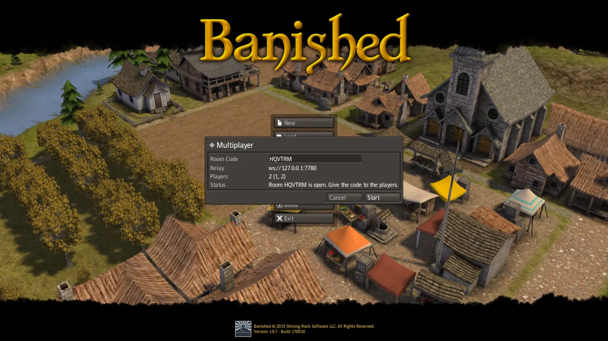
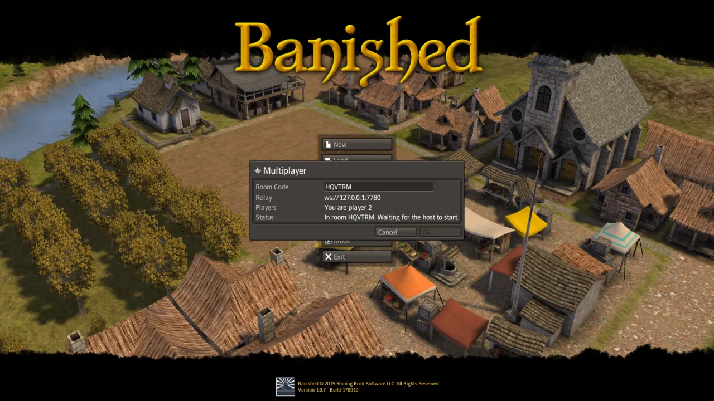
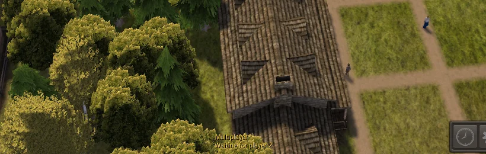

# Multiplayer

Several players can build one town together. Each player sees the same town and can build, give
orders, change the speed and pause, and every change happens for everybody. The original
Banished has no multiplayer: this is a part of Un-Banished that is not in the original game, and
it never changes a single-player game.

<video src="../assets/videos/multiplayer.webm" poster="../assets/videos/multiplayer-poster.webp" autoplay loop muted playsinline width="720"></video>

*Two copies of Un-Banished in one game. Each player places a house, and both houses appear on
both screens.*

## What you need

- **Your own copy of Banished** on every computer. Un-Banished does not send the game files to
  other players; each player reads their own.
- **The same version of Un-Banished** on every computer, and **the same mods**, in the same order.
  The game does not check this yet. If the versions or the mods differ, the towns soon differ,
  and the game keeps reloading the host's town (see [When the towns differ](#when-the-towns-differ)).
- **A relay**: a small program, `banished-relay`, that passes messages between the players. One
  player, or a server, runs it. See [Run the relay](#run-the-relay).
- **A save to play.** A multiplayer game starts from one of the host's saves. To start a new
  town, start it in single player, save it, and host that save.

## How it works

Every computer runs the whole town. The computers do not send the town to each other; they send
only what the players do (place a building, change a setting, pause). Each command is carried out
on every computer at the same moment of game time, about a tenth of a second after it is given.
The game is exact enough that every computer then has the same town.

The first player is the **host**. The host chooses the save, and every 10 seconds compares the
towns of all players. The relay only passes messages on; it does not run the game.

## Run the relay

The relay is part of Un-Banished. Build it in the same folder as the game (see the
[setup guide](../USER-GUIDE.md#3-download-and-build-un-banished)):

```bash
cargo build -p banished-relay --release
```

The relay is then `target/release/banished-relay` (`target\release\banished-relay.exe` on
Windows). Start it in a terminal:

```bash
target/release/banished-relay
```

It listens on port **7780** on every network interface, and writes a line for each room that
opens or closes. To use another address or port, give it as the only option:

```bash
target/release/banished-relay 0.0.0.0:9000
```

Leave the terminal open while you play. Press Ctrl+C to stop the relay.

The relay address that players enter in the game has the form `ws://ADDRESS:PORT`:

| Where the players are | What to do | Address in the game |
|---|---|---|
| All on one computer (for a test) | Start the relay on that computer | `ws://127.0.0.1:7780` (the default) |
| On one home network | Start the relay on one computer. Allow port 7780 (TCP) through that computer's firewall | `ws://` and that computer's local address, for example `ws://192.168.1.20:7780` |
| On the internet, with a home relay | Also forward port 7780 (TCP) on your router to the relay computer | `ws://` and your public address, for example `ws://203.0.113.7:7780` |
| On the internet, with a server | Run the relay on a server or virtual machine, and allow port 7780 (TCP) | `ws://` and the server's name or address |

Only the relay computer needs an open port. The players' computers connect out to the relay, so
they need no port forwarding.

There is no public relay yet: somebody in the group must run one.

**Security.** The relay has no passwords. Anybody who knows the relay's address and the room code
can join a room before the host starts the game. `ws://` is not encrypted. For a relay on the
internet, prefer a TLS proxy and `wss://` (see [In the browser](#in-the-browser)).

## Host a game

1. Start the relay (above).
2. In the main menu, press **Multiplayer**.
3. Check **Relay**: it must be the relay's address. The game remembers the last address used.
4. Leave **Room Code** empty and press **Host**. The window shows the room's code, a word of six
   letters.
5. Give the code and the relay's address to the other players.
6. **Players** shows how many players are in the room. When everybody is in, press **Start**.
7. The Load window opens. Choose the save to play and press **Load**. Every player loads the same
   save, and the game begins.

<p align="center">
  
</p>

To close the room before the start, press **Cancel**.

## Join a game

1. In the main menu, press **Multiplayer**.
2. Type the relay's address in **Relay**, for example `ws://192.168.1.20:7780`.
3. Type the room code in **Room Code**. The button changes from **Host** to **Join**.
4. Press **Join**. The window says which player you are, and waits for the host.
5. When the host presses Start, the game loads the host's save and begins. You do not need the
   save file yourself.

<p align="center">
  
</p>

## Playing together

A line at the foot of the screen says which player you are:

<p align="center">
  
</p>

What one player does happens for everybody:

| Action | In a multiplayer game |
|---|---|
| Build, remove, roads, and every order in a building's window | For everybody |
| Game speed | Shared: the last player to change it sets it for everybody |
| Pause (the pause key or the toolbar) | Pauses the game for everybody |
| The pause menu (Escape) | Does not pause the game; the others play on |
| The camera, windows, selection | Your own; the others do not see them |
| AutoSlow | Always on, whatever each player's option says |
| Autosave | Off |

If one computer is slow, everybody waits for it: the game goes only as fast as the slowest
computer. While the game waits for another player, the town stops, but you can still move the
camera and use the windows. After half a second the line says whom the game waits for:

<p align="center">
  
</p>

## When the towns differ

Every 10 seconds the host compares all players' towns. If one differs, every player reloads the
host's town, behind a short loading screen, and the game goes on from there. Nothing is lost
except the moment it takes. This should be rare. If it happens again and again, the players
probably have different versions of Un-Banished or different mods.

## When a player leaves

A player leaves by quitting the game, by leaving to the main menu, or when their connection
breaks. The others play on without them, and the line says who has left.

If the **host** leaves, the others also play on, but nobody compares the towns any more, and the
line says so. If the towns then differ, nothing reloads them; save, and start again with a new
host.

A player who left cannot join the same game again. To continue together, save the game, and
start a new multiplayer game from that save.

## Saving

Every player can save with the pause menu's **Save**, as in single player. The save is an ordinary
save of the shared town: every player's save holds the same town (only the camera differs). To continue another day, the host
starts a new multiplayer game and chooses that save. A multiplayer save also loads in single
player.

## In the browser

The [browser version](../USER-GUIDE.md#play-in-the-browser) has the same Multiplayer window.

What has been tried, on a page served by `tools/dev-web.sh` (plain `http://`, relay at
`ws://127.0.0.1:7780`):

- A browser player joined a room hosted by a desktop player, loaded the host's save, and played
  in the same town: the host compared the towns 46 times and they never differed.
- A browser can host a room (it gets a code, and others can join it).
- When the desktop host left, the browser played on and showed that the host had left.

Not tried yet: a browser host starting a game from a save in the browser's storage, and
browser commands seen on another player's screen. The code is the same as on the desktop, so
both should work.

A web page served over `https://`, such as the published site, may only connect to a relay over
`wss://` (WebSocket with TLS). The relay itself speaks only `ws://`, so put a TLS proxy in front
of it. With [Caddy](https://caddyserver.com/), on a server with a domain name, this file
(`Caddyfile`) is enough:

```text
relay.example.com {
    reverse_proxy 127.0.0.1:7780
}
```

Caddy gets a certificate for the name, and players then use `wss://relay.example.com` as the
relay address. Native players can use the same `wss://` address.

## Limits today

- The game does not check that every player has the same version and the same mods.
- A player who leaves cannot join again; nobody can join a game that has started.
- There is no public relay, and the relay has no passwords.
- The room code cannot be copied from the window; read it out or type it.
- The published site is served over `https://`, so it can join only a `wss://` relay, and there
  is no public one yet.
- Tested with up to three players over the network, and four on one computer. More should work.

## Troubleshooting

| What happens | Why, and what to do |
|---|---|
| **No connection: …** in the window | The relay is not running, or the address is wrong, or a firewall blocks port 7780. Check that the relay's terminal is open, the address starts with `ws://` (or `wss://`) and has the right port, and that the relay computer allows the port. |
| **The relay: no room …** | The code is wrong, or the host has not pressed Host yet, or the room has closed. Check the code and press Join again. |
| The host's **Start** stays grey | No other player is in the room yet. |
| A player waits at **Waiting for the host to start** | The host has not pressed Start, or has not chosen a save yet. A player who joins after the game has started waits here for ever: they cannot join that game. |
| **Waiting for player N** at the foot of the screen for a long time | That player's computer is slow, paused by the system, or its connection is very slow. If they have left, the game goes on by itself once the relay sees it. |
| The loading screen appears now and then during the game | The towns differed and everybody reloaded the host's town. Check that all players have the same version of Un-Banished and the same mods. |
| The browser cannot connect to `ws://…` | A page served over `https://` cannot use `ws://`. Use a `wss://` relay (see [In the browser](#in-the-browser)). |

The developer notes, with the tests and the design, are in
[MULTIPLAYER-PLAN.md](../MULTIPLAYER-PLAN.md).
