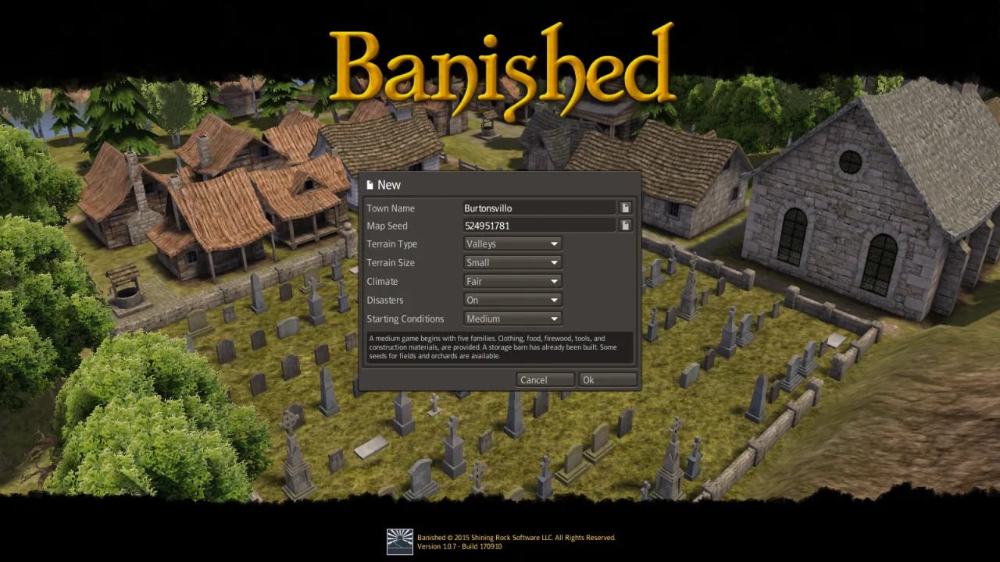

# Playing the game

This page shows Un-Banished running, and explains the first steps in a new town. Un-Banished
plays like Banished 1.0.7, so guides and advice for the original game also apply. The game's own
**Tutorials** (in the main menu) teach the basics step by step.

<video src="../assets/videos/zoom-into-town.webm" autoplay loop muted playsinline width="720"></video>

## Start a new game

In the main menu, choose **New**. The **New** dialog has these settings:

| Setting | Choices |
|---|---|
| Town Name | Any name. The button next to it makes a random name. |
| Map Seed | A number. The same seed and the same settings make the same map. The button makes a random seed. |
| Terrain Type | Valleys or Mountains |
| Terrain Size | Small, Medium or Large |
| Climate | Mild, Fair or Harsh. A harsher climate has longer, colder winters and a shorter growing season. |
| Disasters | On or Off: fires, tornadoes, disease and crop blight |
| Starting Conditions | Easy, Medium or Hard. The text under the settings describes what you start with. |

  

Press **Ok**. The game makes the map, and your settlers arrive next to their first stockpile and
storage.

## The first year

Your citizens are not controlled one by one. You choose what to build and which jobs to
fill, and the citizens do the work. They need food, firewood, a home, clothing and tools. Winter
is the dangerous time: citizens who are cold or hungry become ill and can die.

A common order for the first buildings:

1. **Homes.** Wooden houses for the families. A family needs a home to have children.
2. **Firewood.** A woodcutter makes firewood from logs. Without firewood, homes are cold in
   winter.
3. **Food.** Gatherers, hunters and fishermen give food at once. Crop fields and orchards give
   more food later, but only in the growing season.
4. **Storage.** A storage barn and stockpiles near the work places shorten the walks.
5. **Clothing and tools.** A hunter gives leather, a tailor makes coats, and a blacksmith makes
   tools from iron and logs.

Choose buildings in the toolbar at the bottom right. Its buttons are, in order: time, reports,
housing, transport, storage, services, food, resources, removal, and options. Click a building
or a citizen to open its window. The **Town Hall** window shows your population, your stock and
the production over time. The **Professions** window (in the reports menu) sets how many
citizens do each job.

  

## Citizens at work

Citizens walk between their homes, their work places, the storage and the market. They carry
what they make to storage, and they take food, firewood and clothing home.

<video src="../assets/videos/citizens-market.webm" autoplay loop muted playsinline width="720"></video>

## The seasons

The year has twelve months: three each of spring, summer, autumn and winter. Crops grow from
spring to autumn and must be harvested before the frost. Snow covers the town in winter. This
video shows a town from autumn to the start of spring, at the highest game speed:

<video src="../assets/videos/seasons.webm" autoplay loop muted playsinline width="720"></video>

## Animals

Chickens, cows and sheep live in pastures; deer live in the forest. The [viewer](../../apps/viewer/README.md)
shows each model and plays its animations. This is a chicken's walk:

<video src="../assets/videos/chicken-walk.webm" autoplay loop muted playsinline width="300"></video>

## Game speed and pause

Press **Space** to pause and resume. The toolbar's first button (time) has the pause, play,
slower and faster buttons. The speeds are normal, 2×, 5× and 10×. [Controls](../USER-GUIDE.md#controls) lists every key.

## Save and load

The game saves automatically (**Options → Game**). To save by hand, press **Esc** and choose
**Save**. [Saves and settings](../USER-GUIDE.md#saves) explains where the files are.

The videos on this page were recorded by Un-Banished itself, without a window. See
[Recording videos](../develop/VIDEOS.md).
