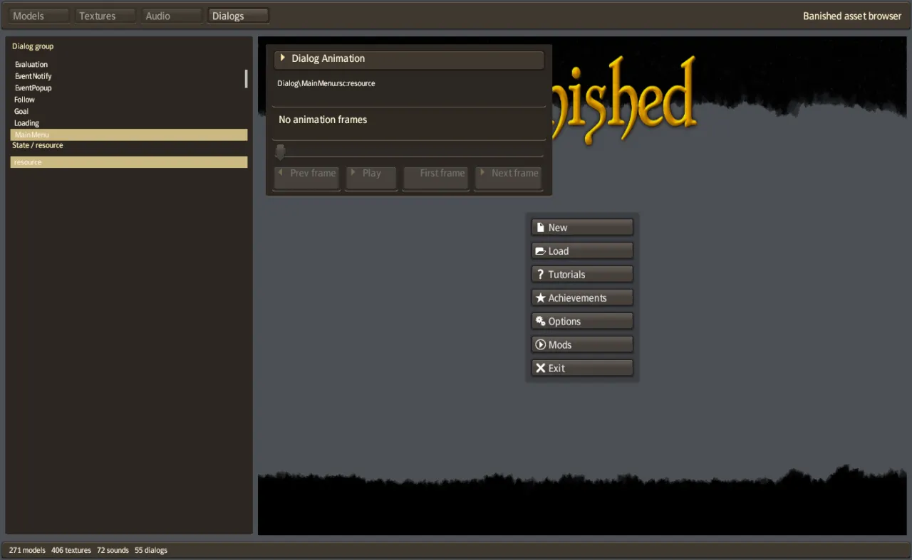

# The interface

Banished ships its interface as data. Every window, button, list and tooltip is a resource in
the `Dialog` folder of the packages, drawn with the game's own sprite sheets and fonts.
Un-Banished does not draw its own copy of these windows. It loads the same resources and lays
them out as the original engine does. The code is in [banished-ui](../../crates/ui/README.md),
and the windows' behaviour is in `apps/game/src/ui/`.

  

## Dialogs and elements

A dialog resource (`Dialog/*.rsc`) is a tree of *elements*. There are many element classes:
groups, layouts, tables, tabs, text, images, buttons, check boxes, lists, combo boxes, sliders,
spinners, scroll bars, progress bars, graphs, edit boxes, and documents with markup. Each element
has a name (for example `buttonNew`), margins, a minimum size, an alignment, and a reference to
its sprites or its font.

A dialog can replace parts of itself with other resources by name (*substitutions*), and it can
attach *controllers* to elements. A controller is game code: for example, the code that fills
the Town Hall's tables. The resource only says which controller goes where.

## Layout

Layout runs in two passes, as in the original engine:

1. **Size, bottom-up.** Each element computes the size it needs from its children, its text and
   its margins (`ComputeSize`).
2. **Place, top-down.** Each element places its children inside the rectangle it was given
   (`ComputeLayout`), by their alignment and the rules of its class.

Text layout follows the original font code: the advance of each glyph, line wrapping, ellipsis
and the shadow. The help pages and the tutorials use documents with markup, with links and
pictures.

## Drawing and input

The interface draws as a list of textured quads, in order, each with an optional clip rectangle.
`banished-gfx` draws them with wgpu in one pipeline. The pointer and the keyboard go through the
element tree: the element under the pointer is *hot*, a pressed button sends a click when it is
released, and an edit box takes the keyboard focus.

## How the game uses it

The game finds elements by their names, as the original does. It never depends on the position of
an element in the tree. For example, the toolbar finds `toolbarContent` and fills it from the
toolbar resources. Strings come from string tables, so the game shows the texts of the original.

The same names make headless tests possible: `--press buttonNew@4.5` clicks the element called
`buttonNew` in a capture. See [Verify](../develop/guides/VERIFY.md).

## Read more

- [UI.md](../UI.md): the element classes and their engine functions.
- [FONTS.md](../FONTS.md), [TOOLTIPS.md](../TOOLTIPS.md), [STATUS-ICONS.md](../STATUS-ICONS.md).
- [IN-GAME-TOOLBAR.md](../IN-GAME-TOOLBAR.md), [UTILITY-WINDOWS.md](../UTILITY-WINDOWS.md),
  [BUILDING-WINDOWS.md](../BUILDING-WINDOWS.md), [OPTIONS.md](../OPTIONS.md): the game's windows.
- [The viewer](../../apps/viewer/README.md) draws every dialog of the game.
